# Catalog Studio — E3D カタログ編集ツールのたたき台

Python / Tkinter で、CATE・SCOM、ポイント・形状定義、SPEC、説明・材質、共通テーブル、PDF カタログ本を管理するデスクトップツールです。SCOM に部品ごとの数値・文字列を登録し、定義側ではパラメータ参照と式を編集します。

[最新版 ZIP をダウンロード](https://github.com/alz7485/codex2/raw/refs/heads/main/catalog-studio-integrated.zip)

## 起動

Python 3.10 以降・Tkinter・Pillow が必要です。Windows は Tcl/Tk を含む公式 Python を使ってください。

```sh
python -m pip install -r requirements.txt
python main.py
```

Windows は初回に `install.bat` を実行後、`start.bat` でも起動できます。requirements.txt には透過表示用の Pillow と PDF 出力用の ReportLab を含みます。

Windows 用 `install.bat` も同梱しています。Linux のシステム Python は `python3-tk` が必要な場合があります。

## カテゴリと作成操作

上部の横メニューは **PTSET → GMSET → SCOM → スペック** の順で、番号を付けず表示します。新しいプロジェクトも PTSET 画面から始まります。最左列には選択中のカテゴリだけの登録一覧を表示します。PTSET では PTSET のみ、GMSET では GMSET のみを表示し、名前・種類で検索できます。カテゴリを切り替えると検索条件をクリアします。ほかのカテゴリへは上部メニューから移動します。

PARAM プリセットは上部の **その他の管理 ▾ → PARAM プリセット** から開けます。管理カテゴリを表示中は、メニューの見出しがそのカテゴリ名になります。

1. **PTSET 新規作成**：左端の PTSET 一覧の上にある **「＋ 追加」** で、名前と PARAM プリセットを選び、空の PTSET を作成します。次に隣の要素欄の **「＋ 追加」** で別窓を開き、説明を読んで PTAXI などを選択して **「PTAXI を作成」** を押します。作成済みのポイントを選び、右の属性セルをダブルクリック、または選択して Enter を押して値・式を入力します。種類を選ぶだけでは要素を追加・変更しません。
2. **GMSET 作成**：上部メニューで切り替え、左端の GMSET 一覧の **「＋ 追加」** で名前とプリセットを選択。隣の要素欄の「＋ 追加」で形状を作り、属性と式を登録します。
3. **SCOM 登録**：上部メニューで切り替え、「SCOM を追加」で使用する PTSET・GMSET・プリセットを選び、部品の数値・文字列を登録します。直前に編集した GMSET がある場合は、適用する PTSET とともに初期選択します。CATE がない場合は同じ画面で新しい所属 CATE を作成できます。
4. **スペック登録**：上部メニューで切り替え、SPEC と登録行を作成し、参照する SCOM を選択します。

SCOM を作る前に実数値を定義へ登録しません。入力ダイアログの確定時に作成し、キャンセルでは新しい部品を追加しません。セットと SCOM の参照は登録画面で指定します。編集した内容はカテゴリ切替後も保持し、JSON に保存できます。次のカテゴリを作成する「次へ」ボタンは置いていません。

ポイントの種類を選ぶと、位置・方向の指定方法と用途を表示します。

| 種類 | 位置の指定 | 方向の指定 |
| --- | --- | --- |
| PTAXI | 軸に沿う距離 PDIS | PAXI |
| PTCAR | PX・PY・PZ | PTCDIR（方向式） |
| PTMIX | PX・PY・PZ | PAXI |
| PTPOS | PTCPOS（位置式） | PTCDIR（PTCD と同じ） |

作成したポイントは自動選択されます。別のポイントは左の一覧から選択して編集でき、同じ種類のポイントも作成ボタンで追加できます。番号は要素一覧の左端に表示します。隣の列は **要素名、その下に小さな文字で種類** を表示します。要素名をダブルクリック、または要素を選択して Enter で一覧内の編集を始め、Enter または別の要素への移動で確定、Esc で取り消します。空の名前や同じ親の中で重複する名前は登録しません。番号・種類・属性は名前の編集で変えません。

PTSET の NUMB は次の未使用番号を初期設定し、編集後の番号も一覧へ反映します。要素をドラッグして並べ替えると、PTSET の番号も先頭から 1、2、3…に振り直します。GMSET の番号は表示順で、形状属性の NUMB は追加しません。

PTMIX は XYZ 座標と PAXI を組み合わせます。プレビューでは `X45Y` などの角度付き方向も計算します。実機へ出力する構文は作成例で確認します。

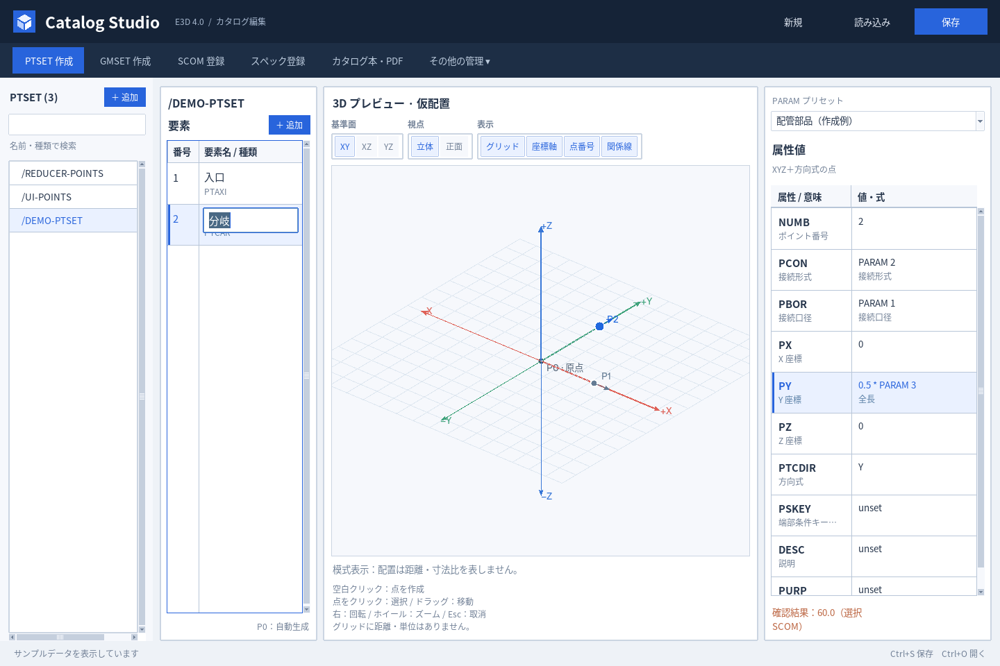

濃紺のヘッダーと横メニュー、白い作業パネルを使ったデスクトップ向けの外観です。ボタン・選択色・入力欄・罫線をそろえ、未入力項目の赤枠は維持しています。

画面は左から **登録リスト → セットの要素 → 3D プレビュー → 属性値** の4列です。上部の横メニューで大項目を切り替えます。PTSET の3D プレビューは中央に常設し、要素一覧とキャンバスの選択、右の属性入力が連動します。GMSET は、対応する PTSET の点・向きと形状を重ねた3Dプレビューです。編集領域の列幅は境界をドラッグして調整できます。

右側の属性表は **属性名、その下に小さな文字で意味** を表示し、隣に **値・式、その下に小さな文字で PARAM の設定名** を置く2列です。たとえば上段に `PARAM 3 / 2`、下段に `全長` を表示します。設定名を括弧で囲みません。属性欄の初期幅を約330pxに絞って、中央のプレビューを広くしています。基本・詳細・共通・ネガティブの属性はタブに分けず、1つの一覧で表示します。意味の行もクリックして属性を選択できます。矢印キー・Home・End で移動し、長い属性一覧はスクロールできます。

値・式の行をダブルクリック、または選択して Enter を押すと、小さな属性編集窓を開きます。値・式の入力欄、PARAM 挿入ボタン、四則演算・÷2・式の整理、確定・取消を1つの窓にまとめています。PARAM 挿入ボタンを押すと「PARAM 3：全長」のような番号と設定名のリストが開き、選択するとカーソル位置へ挿入します。参照種類・番号のプルダウンは常時表示しません。方向や描画フラグは同じ窓で候補を選べます。挿入や候補選択だけでは保存値を変更せず、「確定」または Enter で反映し、「取消」・Esc・窓を閉じる操作で取り消します。説明などの文字属性は、式の補助機能を省いた小さな編集窓になります。表の下に PARAM 挿入欄は置いていません。

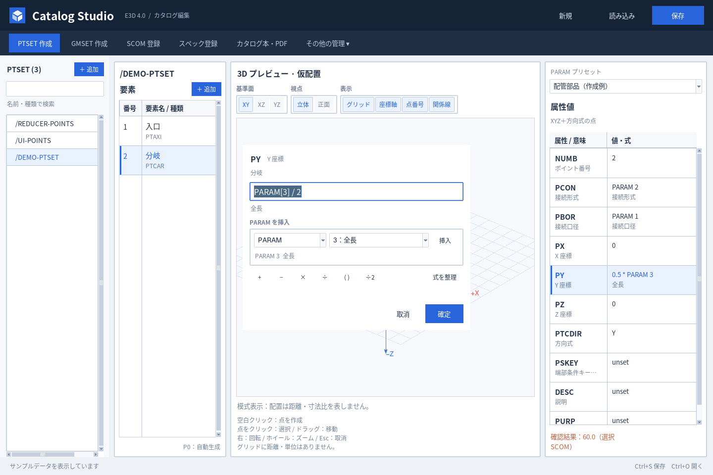

要素の種類は追加時に選びます。作成後の右側には要素名の入力欄や種類変更の選択欄を置かず、属性値だけを編集します。「＋ 追加」はコンパクトなボタンにし、PTSET の種類選択窓も約420×360pxに縮めています。別窓に種類と説明を表示し、作成すると窓を閉じて新しい要素を選択します。「キャンセル」で作成前の種類選択を取り消せます。

- **属性編集窓の PARAM 挿入**：ボタンから開くリストで、PARAM番号と選択中プリセットの設定名を確認して選びます。IPARAM・APARAM・OPARAM・DES 系は同じリストのサブメニューから選びます。設定名が未登録の参照は項目を推測せず、式を直接入力できます。リストを閉じるだけでは式を変更しません。
- **PARAM プリセット**：右側の属性一覧の上で常時選択できます。値・式の下段の設定名を、選択したプリセットの名前へ即時更新します。入力・保存する式には表示用の名前を混ぜません。
- **右クリック → セットの設定・確認**：セット名、プリセット管理、親属性、セット複製、出力確認をまとめています。確認用 SCOM はこの設定欄で選択します。PTSET の仮配置は SCOM の実数値に依存しません。
- **要素一覧を右クリック**：複製・削除、要素プリセットの登録・呼び出し・編集を選択できます。一覧下部の操作プルダウンはなくしました。並べ替えはドラッグします。輪郭・頂点を持つ要素だけ「子要素を追加」を表示します。
- **その他の管理**：上部メニューから構造材、説明・材質、共通テーブル、プリセット、確認・マクロを開きます。PTSET → GMSET → SCOM → スペックと PDF は常時表示します。

保存は上部のボタンまたは Ctrl+S を使用します。要素名と属性値の入力中の内容も確定して保存します。読み込んだ追加属性は同じ属性一覧の末尾に表示し、原文を保持します。未対応の属性は読み取り専用です。

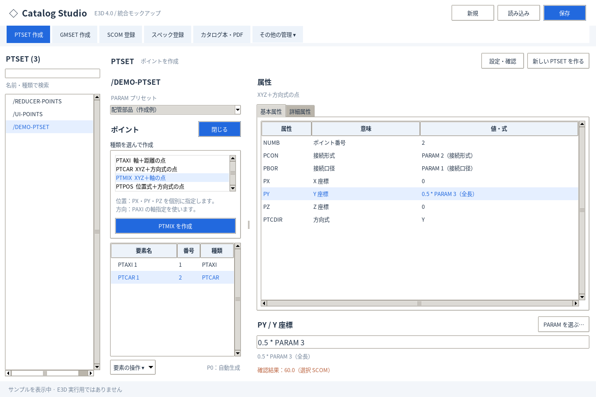

## 要素一覧のプリセット

要素一覧全体をひとまとまりで保存します。要素を個別に選び直して登録する必要はありません。

1. 要素一覧で右クリック → **要素プリセット → 現在を登録**。名前と説明を付けて、全要素・属性・輪郭の子要素・使用する PARAM プリセットを保存します。
2. **呼び出し** で同じカテゴリのプリセットを選び、現在の一覧へ追加するか、一覧を置き換えるかを選択します。呼び出した要素は独立したコピーとして編集できます。
3. **登録したプリセットを編集** で別の編集画面を開き、追加・削除・並べ替え・属性入力を行い、保存します。更新は以後の呼び出しに使い、以前に呼び出した要素や発行済みのカタログ本は変更しません。キャンセルでは登録内容を変更しません。

PTSET では、要素リスト上部の **「PTSET プリセット」** から直接選択できます。空のセットにはそのまま読み込みます。要素が1つでもある状態で別のプリセットを選ぶと、一覧と入力済みの属性値を置き換える確認を表示します。キャンセルすると元の一覧・属性値・選択表示を保持します。同じプリセットを選び直しても編集中の要素は置き換えません。

一覧を置き換える場合と空のセットへの呼び出しでは、プリセットに登録した PARAM の規則も引き継ぎます。既存一覧へ追加する場合は同じ規則を選択してから呼び出します。読み込んだ要素は独立したコピーで、編集しても登録したプリセットは変わりません。使用した要素プリセットの選択は PTSET ごとにプロジェクト JSON に保存します。使用中の PARAM プリセットは削除できません。

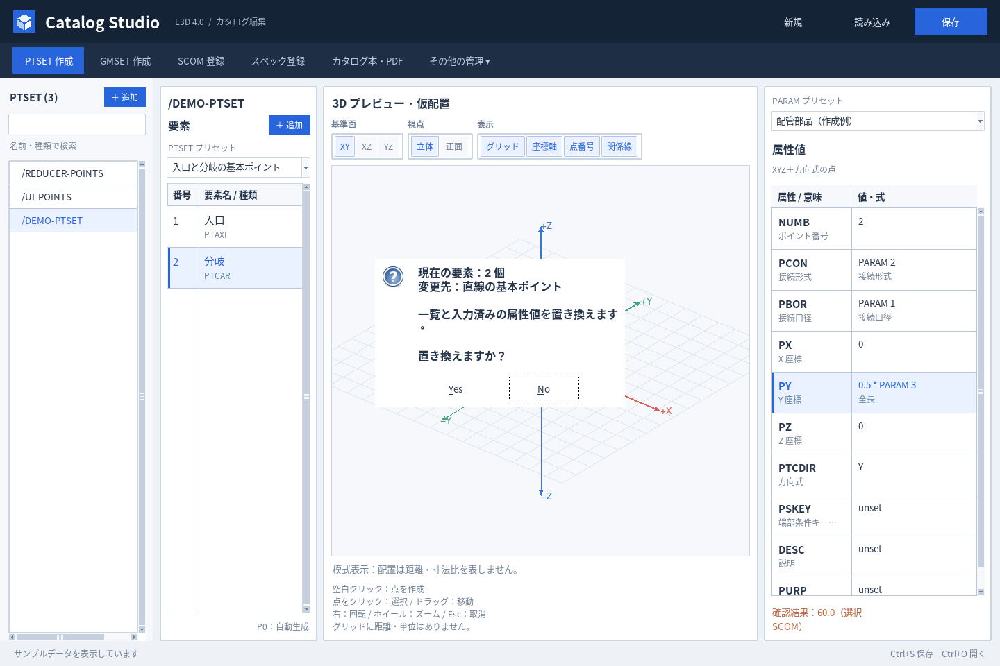

並べ替え時は LINE の P / T 点列と確認済みの単純な点番号による軸参照を更新し、同じ点を参照するようにします。参照する GMSET が別の PTSET と共有されている場合は、先に GMSET を複製して参照を分けます。未解析の複合方向・位置式は原文を保持します。

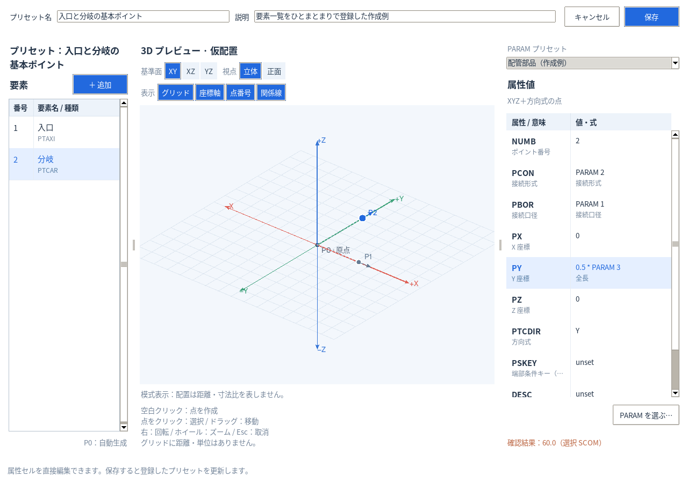

[要素プリセットのサンプル JSON](examples/element-presets-sample.json)を同梱しています。すべて架空の自作データです。

## 今回反映した操作

- **PTSET**：PTAXI・PTCAR・PTMIX・PTPOS の属性編集。PTCD と PTCDIR は表示を統一し、保存時は元の属性名を維持。セットの DESC・GTYP・SKEY・PURP は「右クリック → セットの設定・確認」内の「親属性」から設定。P0 は自動生成される編集不可の基準点として案内します。PSKEY・DESC・PURP も基本属性と同じ一覧に表示し、新規値は unset。
- **GMSET / NGMSET**：18 種の正形状・15 種の負形状を日本語説明と併記。固有属性・共通属性・ネガティブ属性・保持した追加属性を1つの一覧で表示します。同名の属性も要素ごとに意味を表示します。
- **NAPP**：「NAPP 適用先」で Attached / Owner / Self を選択。1・2・4 の組み合わせで 0〜7 を保存し、6 なども扱えます。実際の対象は設計側の文脈に依存します。以前の仮項目 PJOI などは新規属性から除き、既存データの追加属性として保持します。
- **共通属性**：LEVEL は下限・上限、CLFLA・TUFLA・TVISI・BVISI は TRUE / FALSE、OBST は 0 対象外／1 ソフト／2 ハード。描画フラグだけで実機の表示状態が決まるとは扱いません。
- **輪郭**：SEXT / SREV → SLOO → SVER、SPRO → SPVE の子要素を追加。GMSET の輪郭・頂点は同じ親の中でドラッグして順番を変更できます。構造材の編集画面には移動ボタンがあります。頂点の PRAD、構造断面の差分属性を編集できます。以前の親 PRAD は削除せず追加属性で保持します。
- **寸法モード**：LSNO / NLSN は上面・底面ごとに直径または半径を選択。変更前の値は履歴に残します。
- **LINE**：「LINE の点列」で P / T の順序付き参照を最大6個編集。SLINE は始点・終点の位置式を保持します。
- **構造材**：PTSSET / PLINE の基準線と NAREF、GMSSET の SREC・SANN・SPRO を管理。P 系は開始側、D 系は終端までの差として説明します。
- **説明・材質**：SDTE / SMTE を独立レコードで管理。SPEC の登録行で SCOM・SDTE・SMTE を別々に参照できます。SDTE は「ISODRAFT 用」を選んだ場合だけ RTEX と4文字 SKEY の不足を確認します。
- **共通テーブル**：接続コードの組、説明、ボルト関連、標準長さ、公称径・分岐表のレコードと親階層を管理。未確定の属性は「属性 JSON」で保持できます。BTHK はボルト長さ、NUMBER は穴番号として表示します。

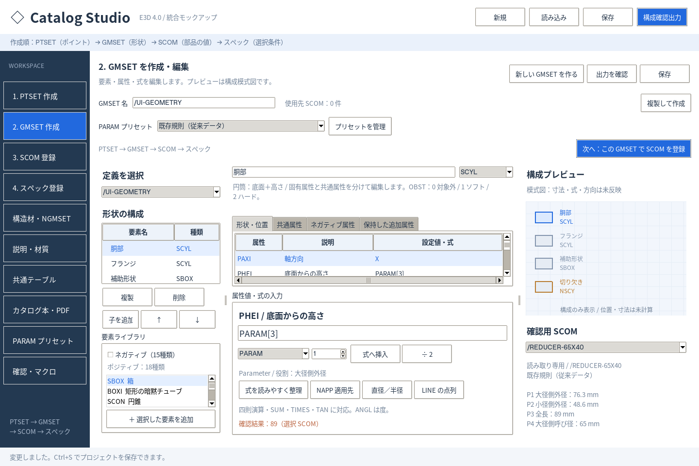

## GMSET に適用する PTSET

GMSET のプレビュー上部にある **「適用する PTSET」** で、対になるポイント定義を選択します。手動選択は GMSET ごとに JSON 保存し、名前を変えても同じ PTSET を参照します。「未設定」で解除し、「対応から自動選択」で自動判定へ戻します。要素一覧のプリセットではなく、GMSET 本体の設定です。

手動選択がない場合は、登録済み SCOM の参照、同じ GMSET を対象とする作成途中の対応を尊重します。未連携の GMSET は、名前から一致する候補を初期選択します。一意に判断できない場合は未選択のまま表示し、一覧の先頭を勝手に使いません。

正式な命名規則は未確定のため、現在は仮の照合ルールを使います。たとえば `/VALVE-PTSET` と `/VALVE-GMSET`、`/PT_VALVE` と `/GM_VALVE`、`/VALVE-POINTS` と `/VALVE-GEOMETRY` などです。部分一致による推測はせず、名前の識別部分が完全一致するものを候補にします。命名規則が決まった後に照合設定を差し替えます。

選んだ対応は SCOM **新規登録** の初期値に使います。既存 SCOM の PTRE / GMRE は、この操作で書き換えません。PTSET と GMSET の PARAM プリセットが異なる場合は表示し、規則を合わせてから部品を登録します。点番号の並べ替えは、SCOM 登録前でも対応する GMSET の既知の点番号参照を更新します。

この対応はツール内の編集情報で、GMSET の E3D 属性を追加するものではありません。

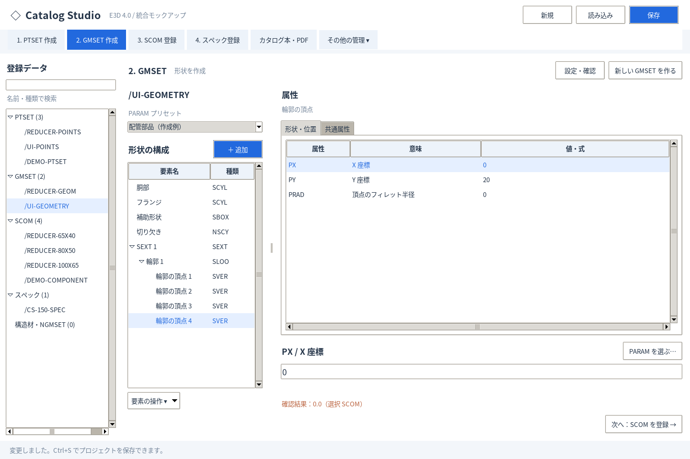

## PARAM プリセットと式

日本語説明は全コンポーネント共通の規則にせず、登録時期やコンポーネントごとにプリセットとして管理します。

1. 「PARAM プリセット」の左の登録一覧で、**＋** から名前を付けて空のプリセットを作成。既存の規則は上部の **複製** から流用できます。
2. 表の **番号・意味・STEXT（意味の英語名）** をダブルクリックして直接編集し、**プリセットを保存**。Enter で確定、Esc で取消、Tab で意味／英語名へ移動します。列はコンパクトな幅で表示し、画面を広げても自動では伸ばしません。番号は自動で振り直しません。**＋行追加** と右クリックの行複製・削除を使えます。
3. PTSET／GMSET 作成画面の、右側の属性一覧の上にある「PARAM プリセット」で、その定義の規則を選択。
4. カタログ画面の「PARAM プリセットを割り当て」で、各 SCOM の規則を選択。

管理画面で選択したプリセットは新規作成用です。選択するだけでは既存 SCOM や定義の割り当てを変更しません。過去の規則を残す場合は複製して新規用を作成します。使用中のプリセットは削除できません。プリセットの編集は、そのプリセットを使うデータだけへ反映します。

「意味」は日本語の説明で、空白や括弧も入力できます。旧データの式用の別名 `role` は互換性のため保持し、表示用の `meaning` と STEXT 用の `english_name` を追加しています。意味・英語名の編集で既存の式や SCOM の値を入れ替えることはありません。英語名のない旧データは空欄表示し、自動翻訳しません。PTSET / GMSET の PARAM 注釈や挿入リストには選択したプリセットの日本語の意味を表示します。

単位・値型・補足は行の右クリックから、登録時期・コンポーネント・適用範囲は上部の **適用範囲** から編集します。SCOM の値がある番号の値型変更、式や要素プリセットで使っている番号の削除・再採番は防ぎます。未保存の編集がある状態で移動すると、保存／破棄／取消を選べます。プロジェクト全体の保存でも、入力中のセルとプリセット編集を確定します。

PARAM プリセット画面には、プリセットの内容だけを表示します。CATE の選択や TEXT 名・STEXT のプレビュー、生成・更新操作は置きません。英語名はプリセットの値として保存し、CATE などを作成する側で TEXT の **STEXT** 用に参照するデータとして扱います。プリセットの保存では既存 TEXT を作成・更新しません。CATE が未登録の状態でも、プリセットを作成・編集できます。

番号と SCOM の登録値を自動で入れ替えたり、単位を変換したりしません。定義に別のプリセットを割り当てる際は、役割名の式を元の番号表記に置き換えて、同名の説明による誤解釈を防ぎます。割り当て前の式は履歴に残ります。SCOM と定義の規則が異なる場合は不一致を表示し、計算を止めます。

SCOM 編集・参照の説明表示・貼り付け・確認には、各レコードに割り当てたプリセットを使います。同じ CATE に複数の規則を混在させられます。旧データの規則は「既存規則（従来データ）」として扱い、明示的に割り当てるまで保持します。プリセットはプロジェクト JSON に保存します。

PARAM / IPARAM / APARAM / OPARAM / DES PARAM / DES APARAM / DES OPARAM を区別します。「参照種類別の役割」もプリセットごとに管理できます。PARAM の値は確認用 SCOM から読み取り、他の種類は「確認用の参照コンテキスト」で明示的に与えます。他の種類へ SCOM の値を自動流用しません。

番号参照の表示にはプリセットの設定名を併記します。`PARA[3]`、`PARAM 3`、`P3` などは元の表記を残して名前を表示します。PTSET / GMSET の属性セルでは、設定名は下段の小さい文字で表示します。複数の参照がある式では `PARAM 3 全長 / IPARAM 1 断熱厚` のように種類・番号を添えます。IPARAM や DESIGN 系には、その参照種類に登録した名前を使い、通常の PARAM の名前を流用しません。登録がない番号には「設定名未登録」を表示します。説明文や引用符内の文字列は注釈を付けず保持します。

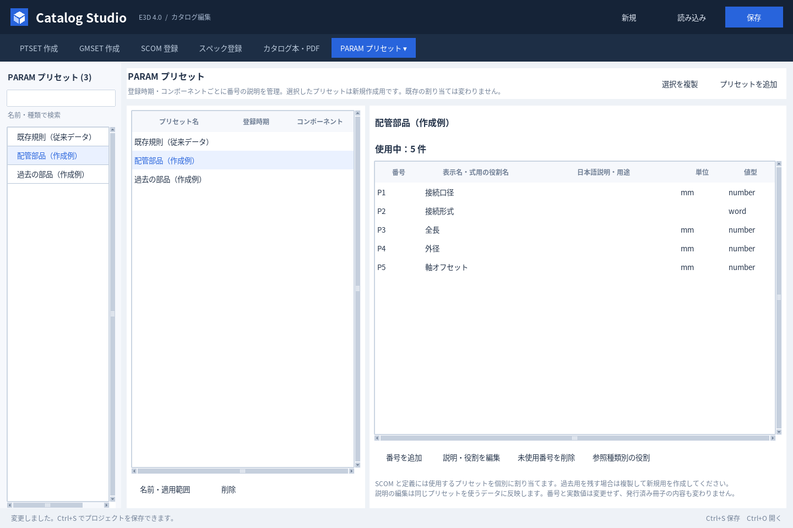

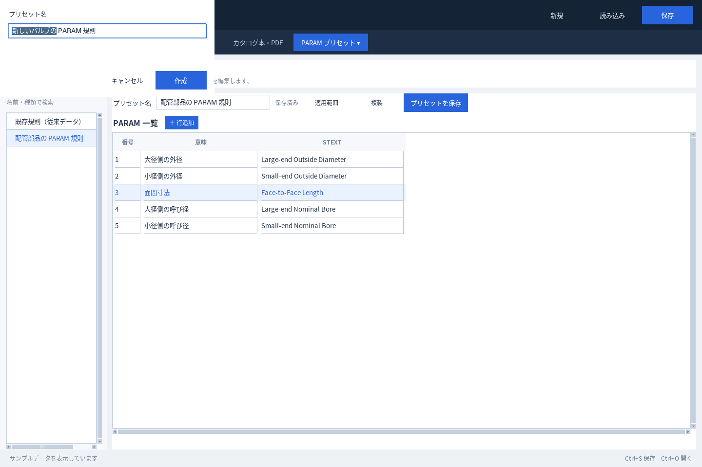

[意味・英語名のサンプル JSON](examples/parameter-text-sample.json)を同梱しています。プリセットと CATE 内の TEXT を含む架空の自作例です。CATE 側の英語名参照を使う作成操作は、プリセット編集とは別に扱います。E3D へ実行するマクロ生成は引き続き未実装です。

[プリセットの混在サンプル JSON](examples/parameter-presets-sample.json)と[サンプル PDF](examples/parameter-presets-book.pdf)を同梱しています。サンプルは架空の説明で、AVEVA の標準パラメータ規則を示すものではありません。

四則演算・括弧・役割名・番号、PARAM 系の複数表記、ATTRIB、SUM、TIMES、TAN に対応。「式を読みやすく整理」で画面用表記へ統一し、整理前の入力も保持します。ANGL は SCOM のコンポーネント属性として度で設定します。数値演算に文字列を使用した場合や、参照値が不足する場合は理由を表示します。

式評価には Python の eval を使いません。複合方向・位置式は原文保持のみです。XYZ を基本とし、E/W/U/D も保持できます。

## 保存と PDF

Ctrl+S で JSON 保存、Ctrl+O で読み込み。旧 v1 データは数値を SCOM へ移して読み込み、既存 v2 の追加属性や未対応要素も保持します。拡張データの編集には最新版を使用してください。

「カタログ本・PDF」で掲載する SCOM と SPEC を選ぶと、参照先の定義・輪郭・構造材・テキスト、SCOM の値と確認用コンテキスト、参照種類の役割・使用した PARAM プリセットを発行時点で固定します。共通テーブルはプロジェクト全体を固定します。以後の編集で発行済みの内容は変わりません。PDF に表と式・属性の役割を掲載し、SCOM の寸法表はプリセットごとに分けます。発行後の説明編集も冊子へ影響しません。

[新しいサンプル JSON](examples/catalogue-rules-sample.json)を「読み込み」から開くと、今回の機能を試せます。すべて架空の自作データです。[サンプル PDF](examples/catalogue-rules-book.pdf)も同梱しています。起動時には以前の参考データを表示し、新しい PTSET / GMSET は未連携の編集例として追加しています。

## 現段階の範囲

PTSET の中央に、点の配置・編集用 **3D プレビュー（仮配置）** を常時表示します。**基準面：XY / XZ / YZ**、**視点：立体 / 正面**、**表示：グリッド / 座標軸 / 点番号 / 関係線** を横1行に並べ、それぞれ枠で囲んでいます。表示の4つは個別のオン・オフです。幅が足りない場合は操作欄だけを横スクロールできます。関係線は原点と各点を結ぶ補助線です。選択・移動モードや表示設定の開閉ボタンはありません。右ドラッグで回転、ホイールでズームします。

**グリッドには mm などの距離・単位の意味がありません。** SCOM を選ばずに点を仮配置し、その配置から PARAM の仮値を保持します。**同じ PARAM を後から設定した点には、すでに保持している仮値を使います。点番号の大小には依存しません。** たとえば先に設定した点の `PDIS PARAM 3 / 2` が仮に1の長さなら、後から設定した点の `PDIS PARAM 3` は2の長さになります。同じ軸・原点で同じ式なら同じ位置、軸が逆なら同じ距離で反対側になります。別の PTSET の仮値は独立しています。

1. **キャンバスの空白を左クリック → 点を作成 ▶ PTAXI / PTCAR / PTMIX / PTPOS** の順に選ぶと、その位置に新しい点が作られます。メニューには種類ごとの日本語説明も表示します。PTAXI は選んだ位置に近い基本軸へ寄せます。
2. 既存点はクリックで選択し、ドラッグして離した位置で移動を反映します。移動中は共有 PARAM の参照点も追従して候補を表示し、Esc で一緒に取り消せます。**PTAXI は設定済み PAXI の軸上だけ**を移動します。`X45Y` なら45度の軸上へ寄せ、`P1` や `P1 P2` の参照軸にも従います。ドラッグで既存の方向式を書き換えません。PTCAR・PTMIX は座標式、PTPOS は位置式に従い、点の向きは維持します。`PY 0` などの設定済み座標も固定します。
3. 距離・非ゼロ座標の式・PTPOS の位置式など、残りの未入力項目は右の値欄を **赤枠** にし、「入力してください」と表示します。値欄から編集窓を開いて値を確定すると赤枠が消えます。PSKEY・DESC・PURP の unset は入力要求に含めません。接続用 PCON・PBOR は利用する部品に応じて設定します。

ドラッグの長さは表示用の仮寸法として保持し、E3D の数値や PARAM 式、SCOM の登録値は変更しません。**共有しているどの点を動かしても、式に応じて PARAM の仮値を更新し、参照している全点に反映します。** たとえば `PARAM 3 / 2` の点を0.5動かすと、`PARAM 3` の点の距離は1変わります。属性で同じ PARAM を指定し直したときも既存の仮値を使い、番号変更や並べ替えでは仮値を変えません。新規配置では方向の初期候補とゼロ座標を設定し、未入力の距離・非ゼロ座標は右の赤枠から入力します。

定数・四則演算・PARAM の表記違い、値の決まる TAN 式などを共有します。複数の未定 PARAM を含む式は、各 PARAM の値を勝手に分解して決めません。同じ複合式の寸法は共有し、個々の PARAM が必要な式は未定として表示します。複数の独立した PARAM の変更量をドラッグだけで一意に決められない場合も、理由を表示します。ANGL が未設定の方向式や、解釈できない位置・方向式は理由を表示し、方向を推測してドラッグしません。

仮配置は E3D の属性とは別の `schematic_position`、共有仮値は PTSET ごとの `schematic_dimensions` として、プロジェクトの保存・再読込と要素一覧プリセットに保持します。プリセットを既存の点へ追加する場合も既存の共有仮値を使い、一覧全体を置換する場合はプリセットの仮値を使います。GMSET の仮サイズ表示にも同じ点位置を使い、SCOM 実寸表示は実際の値を使います。P0 は原点で編集できません。点は従来より大きくし、選択中の点は大きな青い点・外周リング・太字の番号で手前に強調表示します。

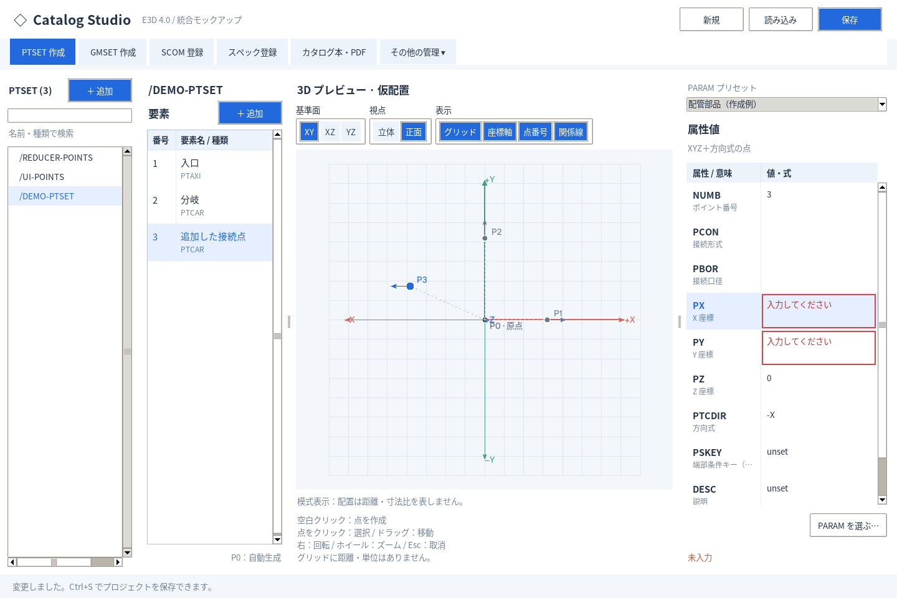

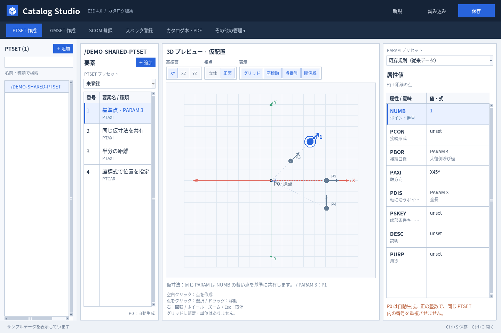

[仮寸法の共有サンプル](examples/ptset-shared-dimensions.json)では、P1 の45度の軸・PARAM 3、P2 の同じ長さ、P3 の半分の長さ、P4 の座標式を確認できます。どの点をドラッグしても共有仮値が更新され、各点がそれぞれの式と軸に従って追従します。架空の自作データです。

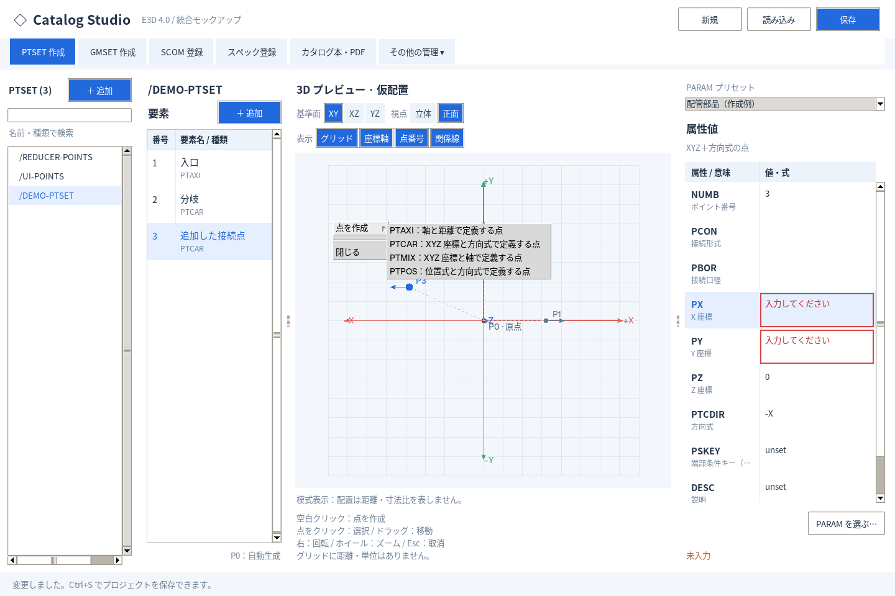

## GMSET と PTSET の3Dプレビュー

中央上部で **適用する PTSET** を選び、以下の2つの表示を切り替えます。

- **仮サイズ**：PTSET の仮配置と形状を重ね、寸法式に同じ PARAM を使う点・形状で仮値を共有します。後から同じ PARAM を設定すると既存の仮値を使い、点番号や要素の順序には依存しません。形状をクリックして選択し、X・Y・Z の色付きハンドルをドラッグすると、どの形状からでも共有仮値を更新できます。同じ PARAM を使う点・他の形状が、それぞれの式と軸に従って追従します。ドラッグ中は仮表示だけを更新し、マウスを離すと確定、Esc で取り消します。PARAM 式・属性値・SCOM の数値は保持します。グリッドと仮サイズには距離や単位の意味がありません。
- **SCOM 実寸**：中央の SCOM リストから登録済み部品を選ぶと、PTSET の位置・方向と GMSET の寸法を式から計算します。表示中の GMSET を参照する SCOM のみ候補に表示します。形状の寸法比を保ち、大小にかかわらず全体が表示枠に収まるよう自動調整します。ウィンドウ変更・右ドラッグによる回転後も収め直します。外形の数値も表示します。実寸表示にはサイズ変更用ハンドルを表示しません。

共有仮値は `schematic_dimensions` として保存・再読込・要素プリセットに保持します。対応する PTSET があり PARAM プリセットが同じ場合は、その PTSET と共有します。PTSET を未設定で使う GMSET は独立した仮値を保持します。PARAM を含まない形状は従来の `schematic_scale` による調整を使い、初めて PARAM を設定した寸法には調整済みの仮サイズを使います。PARAM 寸法に従う形状は、以前の要素別の倍率より共有値を優先します。複数の PARAM の変更量を一意に決められないハンドルや、変更できる PARAM がない軸では、理由を表示します。

[点と形状の共有仮値サンプル](examples/gmset-shared-dimensions.json)では、全長 `PARAM 3` の円筒と半分の長さの円筒を用意しています。どちらの長さを変えても、もう一方の円筒と PTSET の点が追従します。架空の自作データです。

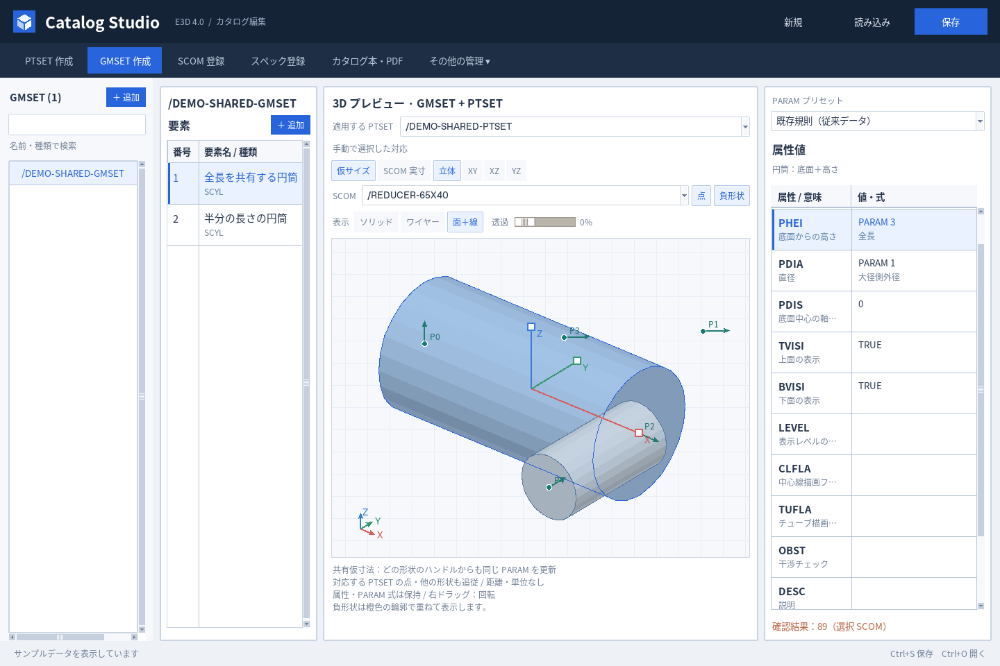

視点は **立体 / XY / XZ / YZ** のトグル、点と負形状の表示も個別トグルです。形状のクリックは要素一覧・右の属性と連動し、属性の確定後に再描画します。

**表示** のトグルで以下を選べます。メッシュの形状データはそのまま使用し、円筒側面の分割線や平面の対角線を隠します。

- **ソリッド**：面を塗って表示。メッシュの分割線を描かないため、面の形が見やすくなります。CAD のソリッド演算へ変換する操作ではありません。
- **ワイヤー**：面を隠し、外形・角・端面の境界だけを表示。滑らかな曲面の細かい分割線を省きます。透過度スライダーは無効になります。
- **面＋線**：面と簡略な輪郭線を重ねます。

**透過** スライダーは0%（不透明）〜100%（面が見えない）です。途中の値では前後の面をアルファ合成し、内部・奥の形状が透けて見えます。点・負形状の輪郭・サイズ調整ハンドルは見える状態を保ちます。表示設定は画面を移動しても保持しますが、PTSET / GMSET の属性・SCOM・保存済みプロジェクトは変更しません。透過表示は表示用メッシュの面順で合成するため、交差形状の厳密な CAD 隠面処理は行いません。

狭いプレビューでは表示操作の1行だけを横スクロールできます。不透明表示は従来の描画経路を使い、透過表示だけに画像合成処理を使用します。透過度スライダーの連続操作はまとめて再描画します。

[輪郭線・透過表示のサンプル JSON](examples/gmset-display-sample.json)には内部の筒を追加しています。「面＋線」と透過65%で内部を確認できます。

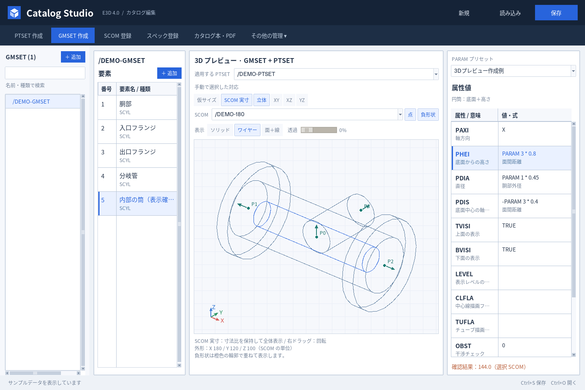

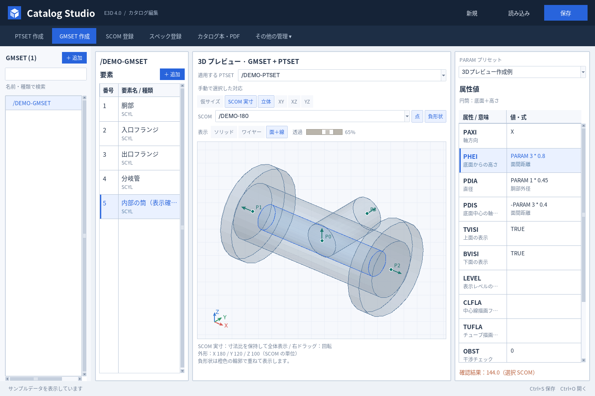

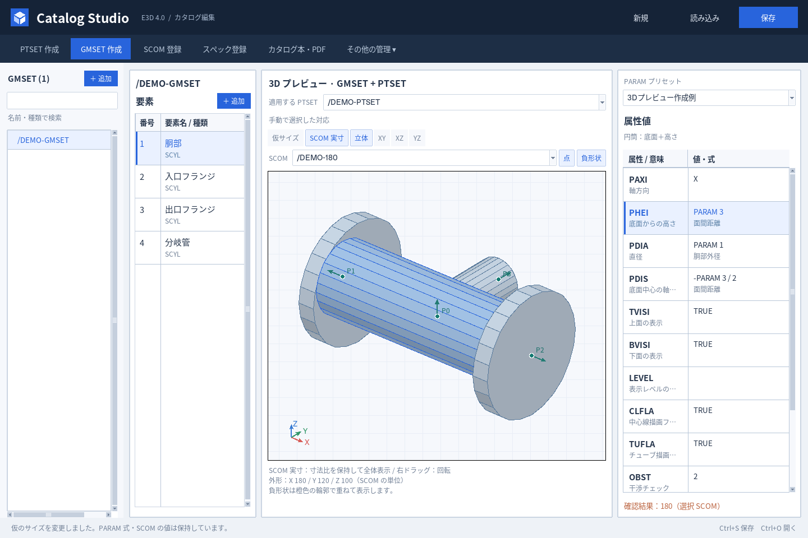

[3Dプレビューのサンプル JSON](examples/gmset-3d-sample.json)を上部の「読み込み」から開き、GMSET 画面で `/DEMO-180`、`/DEMO-SMALL`、`/DEMO-LARGE` を切り替えて試せます。3つの部品は寸法の桁が異なり、同じ寸法比で表示枠に収まります。すべて架空の自作データです。

円筒・箱・円錐・球・円板・矩形／円形レデューサー・輪郭の押出し／回転・点列などをメッシュで表示します。`PAXI P1` などの軸は PTSET の点位置・向きから配置し、PTCAR・PTMIX の XYZ、PTPOS の明示的な XYZ 位置式、基本軸と対応する角度付き方向式を計算します。ANGL は度として扱います。トーラスは端面のポイント位置と法線から円弧が決定できる場合に計算します。

SCOM と PTSET / GMSET の参照先・PARAM プリセットが一致しない場合、未入力値や未対応式がある場合は理由を表示します。SCOM 実寸表示で仮の寸法に置き換えることはありません。IPARAM・Attached・Owner・Design 系には明示的な参照コンテキストが必要です。

負形状は橙色のワイヤーフレームを重ね、ブーリアンによる穴あけは行いません。暗黙チューブ BOXI / TUBE の実寸に必要な設計側配置、SDSH の実寸曲面、NSRU、LINE の接線点 T の曲線、輪郭頂点の非ゼロ PRAD のフィレットは未対応として表示します。曲面は分割した表示用メッシュで、E3D 実機との一致は未検証です。

設計側の Attached / Owner の自動解決、実機出力ファイルの解析、PMSET、実行用カタログ・SPEC マクロは未実装です。「構成確認出力」の `.mac` は全行コメントです。画面用の式整理は実機コマンドへの変換ではありません。

NSRU の固有属性、複合方向・位置式の詳細、SDSH の PDIS 基準面、公称径・分岐表の一部の階層名は確認待ちとして扱います。接続の自動反転やボルト長さ計算も未実装です。正確な実機動作は作成例で確認してから追加します。

提供されたマニュアル写真、ページの転載、原図はリポジトリ・ZIP・PDF に含めません。画面画像と掲載データはツールで作成したサンプルです。

## Windows onedir EXE 化

`build_onedir.bat` と [手動ビルド手順](BUILD_ONEDIR.md)を同梱しています。Windows でビルド後、`dist\CatalogStudio\CatalogStudio.exe` を起動します。配布にはフォルダー全体が必要です。Windows EXE 自体は未ビルド・未同梱です。

## 開発・検証

```sh
python -m pip install -r requirements.txt pypdf
python -m unittest discover -s tests -v
```

GUI は表示環境、PDF 内容の検証は pypdf が必要です。クラウドの仮想ディスプレイで、GUI・PDF のテストと上部メニューのクリックによる画面遷移を検証しています。Windows 実機は未確認です。

命名規則の照合設定はプロジェクトの `set_pairing_name_rules` で差し替えられます。各項目に `ptset` と `gmset` のテンプレートを指定し、共通の識別部分を `{name}` とします。テンプレートごとに `{name}` は1か所です。例：`[{"ptset":"/LIB/P-{name}","gmset":"/LIB/G-{name}"}]`。この設定の専用管理画面は現段階ではありません。保存した手動の対応は規則変更でも維持します。
