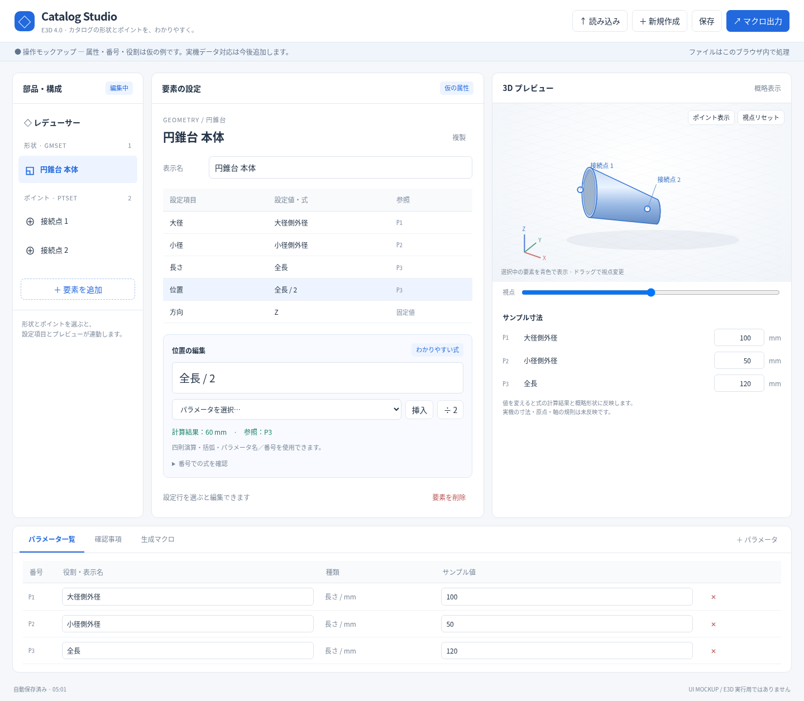

# Catalog Studio — 操作モックアップ

`index.html` をブラウザで開いてください。依存ライブラリやビルドは不要です。

## GitHub からダウンロード

[モックアップ ZIP をダウンロード](https://github.com/alz7485/codex2/raw/refs/heads/main/catalog-studio-mockup.zip)し、展開後の `index.html` をブラウザで開いてください。

リポジトリの **Code → Download ZIP** から一式を取得することもできます。



ローカル HTTP サーバーを使う場合：

```sh
cd /workspace/codex2
python3 -m http.server 8000 --bind 127.0.0.1
```

## 操作できること

- 円筒・円錐台・箱・接続ポイントの追加、選択、複製、削除
- 属性に対する固定値、パラメータ名／番号、四則演算・括弧の入力
- パラメータ番号・役割の一覧、役割名の編集、サンプル寸法の変更
- 寸法に連動する SVG の概略プレビュー、視点変更、ポイント表示切替
- JSON への保存、同形式 JSON の読み込み、ブラウザ内の自動保存
- 式・名前・正の寸法の基本確認、構成確認用のコメントファイル出力

## 仮の仕様

属性、要素、番号、役割、寸法は UI 検討用です。E3D 出力データの解析、PMSET 対応、実機の位置・方向・接続規則、正確な CAD 表示、E3D 用の式変換と登録マクロ生成は未実装です。

プレビューは主に寸法と軸上位置を表す概略図です。方向選択は保存されますが、図への方向反映は未対応です。複数形状は見やすさのため位置を少しずらして表示します。出力する `.mac` はコメントのみで、実行用の部品登録マクロではありません。

実機の要素一覧・作成例を確認後、属性スキーマ、パラメータ規則、式の変換、読み込み・出力仕様を確定します。
