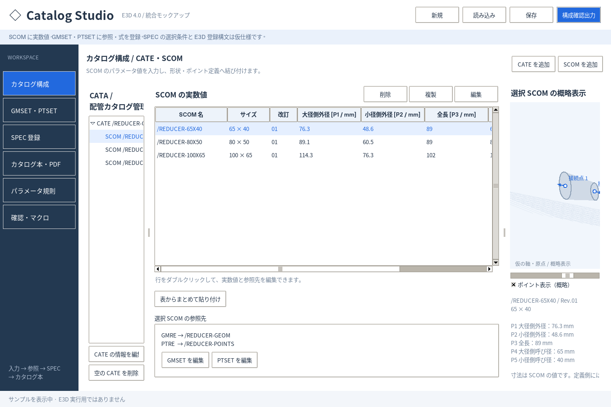
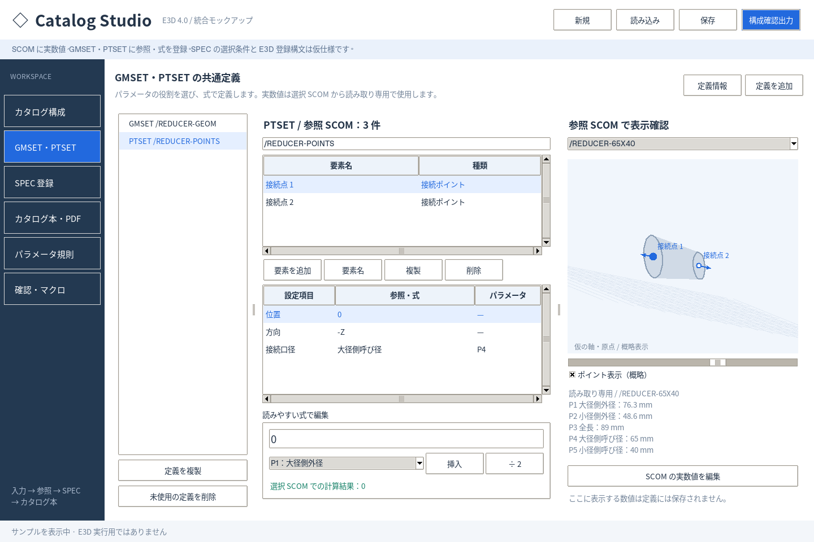
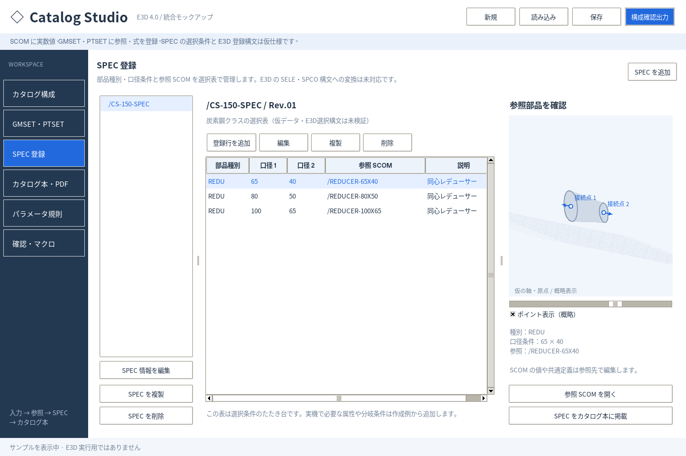
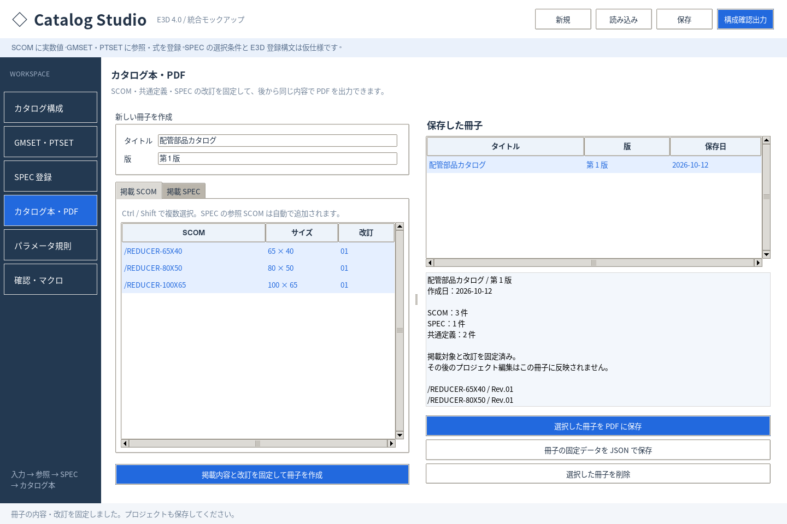

# Catalog Studio — E3D カタログ・SPEC 統合モックアップ

Python デスクトップ上で **CATE・SCOM / GMSET・PTSET / SPEC / カタログ本** をまとめて操作するたたき台です。実機の要素一覧・作成例を受け取る前の段階で、入力・参照・管理・PDF 保存の流れを検討するためのツールです。

**実数値は SCOM に保存します。GMSET・PTSET は共通の要素・パラメータ参照・式として保持します。SPEC は SCOM を参照する仮の選択表です。**

## ダウンロードと起動

[統合版 ZIP をダウンロード](https://github.com/alz7485/codex2/raw/refs/heads/main/catalog-studio-integrated.zip)して展開してください。

Python 3.10 以降と Tkinter を使います。編集画面の起動だけなら外部 Python パッケージは不要です。

```sh
python main.py
```

Windows では Tcl/Tk を含む公式 Python をインストール後、`start.bat` でも起動できます。Linux は通常 `python3 main.py` です。Tkinter がない場合、ディストリビューションの Tkinter パッケージ（例：Debian/Ubuntu のシステム Python なら `python3-tk`）が必要です。macOS は Tcl/Tk を含む Python を使用してください。GUI が使えることは `python -m tkinter` で確認できます。

PDF を保存する場合は、同じ Python に ReportLab をインストールしてください。

```sh
python -m pip install -r requirements.txt
```

Windows は `install.bat` から PDF 用のライブラリをインストールできます。`python -m catalog_studio` も起動コマンドとして使えます。

## 画面と操作

### カタログ構成 / CATE・SCOM

- CATE の追加、説明・改訂の編集、空 CATE の削除。
- SCOM の追加・編集・複製・削除。実数値は SCOM の `values` にのみ保存。
- パラメータの列見出しに番号・役割・単位を併記。
- 表の行をダブルクリックすると、名前、サイズ、改訂、GMRE/PTRE 参照先、実数値の編集画面を表示。
- Excel 等からタブ区切りでまとめて貼り付け。順序は `SCOM名、サイズ、P1、P2、…`、見出しなし。参照先は選択中の SCOM から引き継ぎ。
- 選択した SCOM の値と共通定義を組み合わせて概略プレビュー。



### GMSET・PTSET の共通定義

- GMSET/PTSET の追加、複製、情報・改訂の編集、未使用定義の削除。
- 形状は円筒・円錐台・箱、ポイントは接続点の仮スキーマ。
- 要素を選択し、属性の式を役割名／番号、四則演算、括弧で編集。
- 実数値の編集欄を持たず、確認用 SCOM の登録値を読み取り専用で表示。
- 参照している SCOM 件数を表示。共通定義の変更は使用先に反映。
- 未対応要素は原文を保持し、読み取り専用。推測した形状を表示しません。



### SPEC 登録

- SPEC の追加、情報・改訂編集、複製、削除。
- 登録行で部品種別、口径条件1・2、参照 SCOM、説明を設定。
- 登録行の追加・編集・複製・削除と、参照 SCOM への移動。
- 同じ選択条件の重複や参照切れを確認画面で表示。

**SELE・SPCO の実機構造、選択条件の分岐、正式な属性・コマンドへの変換は未実装です。** SPEC は概念的な登録操作を試すための表です。



### カタログ本・PDF

- 掲載する SCOM と SPEC を複数選択。SPEC が参照する SCOM は自動掲載。
- タイトルと版を入力し、掲載時のパラメータ規則・SCOM 値・CATE・共通定義・SPEC をコピーして改訂固定。
- 発行用データは後のプロジェクト編集から独立し、プロジェクト JSON に保存。固定データだけの JSON 保存も可能。
- 固定データから A4 PDF を出力。表紙、収録一覧、CATE 別寸法表、SCOM 概略図、SPEC 表、共通定義・式、日付・改訂・頁番号を掲載。
- 長い表は改頁し、欠損値や解釈できない式がある図は表示不可と理由を記載。
- 日本語は標準日本語 CID フォントを使用。PDF ビューアにより代替フォントの見た目は異なることがあります。



[サンプル PDF を見る](examples/catalog-book.pdf)

### パラメータ規則 / 確認・マクロ

番号と役割・単位を管理します。役割名の変更に合わせて式を更新し、SCOM の番号と発行済み冊子は変更しません。現段階ではプロジェクト共通の一組の規則です。

確認画面では参照先、値の不足、不正な式、名前と SPEC 条件の重複を確認します。構成確認用 `.mac` は全行コメントで、E3D 登録用の実行マクロではありません。

## 保存とサンプル

プロジェクトは JSON に明示的に保存します。Ctrl+S で保存、Ctrl+O で読み込み、Ctrl+N で新規作成。未保存のまま閉じる・読み込む・新規作成する場合は保存を確認します。

初回は3サイズの SCOM、GMSET/PTSET、SPEC を含む仮データを表示します。[examples/integrated-sample.json](examples/integrated-sample.json) から同じサンプルを読み込めます。

旧ブラウザ版／Python 単体版の v1 JSON は、数値を一つの SCOM に移す形で読み込みます。保存後は統合版 v2 JSON になり、旧ブラウザ版では読み込めません。既存の追加属性や未対応要素は保存時に捨てません。

## 未対応の範囲

E3D 実機出力の解析、PMSET、正式なプリミティブ・ポイント属性、E3D 特有の式変換、実行用カタログ／SPEC マクロ生成、実機での接続・選択確認は未対応です。

CATA は一つのプロジェクト表示、CATE はその下の管理単位として扱う仮モデルで、SECT を含む全階層の編集は未対応です。プレビューも正確な CAD 表示ではなく、仮の原点・軸の規則で先頭12形状を表示します。PDF と画面の概略図は、実機作成例に合わせて後で整合させます。

Windows/macOS の実機起動は未確認です。開発環境の Tk 8.6 と Tk 9.0、および仮想ディスプレイ上で GUI 操作を確認しています。

## 開発・検証

```sh
python -m unittest discover -s tests -v
```

PDF の内容検証にはテスト用に `pypdf` を使います。未インストールの場合 PDF 内容のテストはスキップします。GUI テストは表示が使える場合のみ実行します。開発環境では GUI・PDF を含む37件が成功しています。

- `catalog_studio/integrated.py`：統合画面
- `catalog_studio/project.py`：統合データ・参照・保存・旧形式移行
- `catalog_studio/booklet.py`：改訂固定・PDF
- `catalog_studio/model.py`：式解析
- `catalog_studio/app.py` / `index.html`：以前のモックアップ資料
