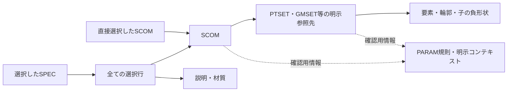

# 出力前確認と E3D 出力の設計

設計日: 2026-10-16。現行コードの基準点: `07e55ee`。

状態: **次の開発に使う設計案。ここに記載する新機能は未実装。** ユーザーの「設計を続けて」に基づき、写真の仕様メモと現在のコードを照合して具体化した。以下の段階分け・内部形式は開発上の判断であり、E3D の仕様やユーザーが個別に指定した操作として扱わない。

参照: [ユーザー要件](../knowledge/user-requirements.md)、[仕様メモ](../knowledge/e3d-specification-notes.md)、[矛盾・未確認事項](../knowledge/open-questions.md)、[実機確認ケース](e3d-verification.md)。

## 1. 目的と現在との差

選択した SCOM または SPEC について、必要な定義・参照先を確認し、修正すべき場所へ戻れるようにする。その確認時点の構成を固定し、将来は E3D 4.0 で確かめた範囲から実行用ファイルを生成する。

| 現在の実装 | 次の設計で加えること |
| --- | --- |
| `project.validate()` は保存形式を検査し、未完成の下書きを保持する | 保存形式の検査を維持し、出力対象の診断を別に行う |
| `project.issues()` / `catalogue.definition_issues()` は問題を文章で返す | 対象・属性・原因コードを持つ診断結果と編集への導線 |
| `IntegratedStudio.build_checks()` は全体の文章一覧 | 対象選択、診断表、参照により含まれるものの一覧 |
| `project.macro_text()` は全行 `$*` コメント | 同じスナップショットによるレビュー JSON と可読レポート |
| CATE・定義・SCOM は別配列。CATA/SECT は共通表管理に存在する | 出力先の所有階層を明示する対応付け |
| 配管 SCOM 形式で PTSET/GMSET 両参照を要求する | 部品クラス・GTYPE と対応機能に応じた参照規則 |

現行の `booklet.snapshot()` は冊子向けに全共通表を固定し、PTSET/GMSET 両参照も要求する。独立コピーという方式は参考にするが、出力依存関係の収集へそのまま転用しない。

## 2. 開発を進める順序

| 段階 | 完了するもの | 完了の判断 |
| --- | --- | --- |
| A: 出力前確認 | 構造化診断、対象選択、編集箇所への移動 | 下記 A01–A06 を満たす。既存の保存形式 v2 は変更しない |
| B: 構成の固定 | 依存関係、所有先・出力名の対応付け、レビュー出力 | B01–B07 を満たす。所有先の未設定も理由付きで記録できる |
| C: 限定した実行出力 | 実機確認済みの対応表と生成処理 | 対応する実機確認ケースに証拠があり、C01–C05 を満たす |

**直近の実装対象は A。** B までは E3D コマンドを生成しなくても完結する。構造材の全対応、SPEC 選択構文、既存 DB の更新、一般マクロ読込は C の初回範囲に含めず、別の対応表で拡張する。

段階Aの詳細は[対象別の確認と編集箇所への移動](scoped-diagnostics.md)。画面状態、診断コード、編集先の対応、取消、検査結果が古くなった場合、移行単位を具体化している。読取可能な全体索引を作れない場合は検査を中止し、特定の枝だけが読めない場合はその枝を明示して一部未確認とする。

## 3. 画面と操作

上部の PTSET → GMSET → SCOM → スペック、4列の編集画面は維持する。「その他の管理 → 確認・マクロ」の中を拡張する。SCOM / SPEC の操作にも「この対象を確認」を追加し、選択 ID を引き継ぐ。

```text
出力前確認
対象: [選択SCOM / 選択SPEC / プロジェクト全体]  [対象を選ぶ] [再確認]
入力・参照: 修正が必要 2 / 要確認 1 / 案内 1     実機: 未確認

[問題] [含まれる定義・参照先] [出力内容]
種別       対象 / 属性                         内容
修正が必要 部品A / GMSET参照                   参照先が見つかりません
要確認     定義B / 出力先                      所有するSECTが未指定です

[編集箇所を開く]                         [構成確認ファイルを保存]
```

- 対象選択窓はチェック一覧と検索を持つ。「全体」以外は明示した選択だけを根にする。対象ゼロなら選択を案内し、全件へ自動変更しない。
- SPEC を選ぶと全行と参照 SCOM が対象になる。初回は SPEC の行単位の除外を設けない。
- 診断行のダブルクリックまたは「編集箇所を開く」で、カテゴリ・対象・要素・属性まで選択する。移動だけで値を変更せず、既存の未確定入力の確定・取消処理を通す。
- 保存前に対象や内容を変更した場合は「確認後に変更あり」と表示し、再確認してから新しいレポートを作る。前回結果を現在の結果として表示しない。
- 通常の JSON 保存は未完成のまま可能。診断がある場合もレビューを保存できる。実行出力の可否は別に表示する。
- 「入力・参照確認済み」と「E3D 実機確認済み」を分ける。エラー0件を E3D 互換性の保証に使わない。

## 4. 診断の契約

新設予定の `diagnostics.inspect_project(data, roots=None)` は入力を変更せず、構造化結果を返す。`roots=None` は全体、空配列は対象なしとする。参照は `{source, collection, id}` で識別し、ID が全配列で一意とは仮定しない。A の `source` は `project`。B で追加する出力設定内の階層は `profile` とし、プロジェクト内の同じ ID と区別する。

```json
{
  "code": "REF_MISSING",
  "severity": "error",
  "target": {"source": "project", "collection": "scoms", "id": "demo-part-a"},
  "element_path": [],
  "field": "gmset_id",
  "context": null,
  "message": "GMSET の参照先が見つかりません。",
  "blocks": ["execution"],
  "evidence": {"kind": "project_data", "source": "gmset_id"}
}
```

- `severity` は `error / warning / info`。画面の「修正が必要／要確認／案内」に対応する。重大度、実行出力を止めるか、仕様の根拠を別々に保持する。
- `target` はデータの出所・所属配列・レコード ID。要素は `element_path` に子までの ID 列を保持する。SPEC 行の ID もここに格納し、表示順番号には依存しない。
- `context` は評価に使った SCOM の参照。共有定義が SCOM A で成功、B で失敗した場合を区別する。SCOM を要しない定義検査では `null`。
- `blocks` は初回は `execution` のみ。レビュー保存や通常保存を止めるフラグに流用しない。全体索引を作れない構造は `STORAGE_INVALID` として通常の対象診断を中止する。特定の枝だけを読めない場合はその枝を明示して一部未確認とし、推測による一覧を作らない。
- `evidence.kind` は `project_data / tool_rule / manual / runtime`。資料は節と R 番号、実機は証拠 ID・対象バージョンを参照する。単に資料にある項目を `runtime` にしない。
- 同じ原因の重複は code・target・element_path・field・context の組でまとめる。原因が参照切れなら、その先の値不足を大量に派生表示しない。

初回の原因コードは次を用意する。コードは日本語文章を解析して後付けせず、検査した場所で生成する。

| コード | 内容 | 主な移動先 |
| --- | --- | --- |
| `STORAGE_INVALID` | 保存構造・識別子の形式が不正 | 読込エラーの詳細 |
| `REF_MISSING` / `REF_TYPE` / `REF_AMBIGUOUS` | 参照切れ・型違い・配列未指定IDの複数候補 | 参照元の選択欄 |
| `NAME_CONFLICT` | 対象内の名前衝突 | 対象の名前 |
| `PARAM_MISSING` / `PARAM_TYPE` | 実値不足・数値/WORD不一致 | SCOM の該当 PARAM |
| `PRESET_MISMATCH` | SCOM と定義の PARAM 規則が不一致 | プリセット選択 |
| `EXPR_UNSUPPORTED` / `DIMENSION_MISMATCH` | 評価できない式・既知の物理次元の不一致 | 定義の該当属性 |
| `OWNER_UNMAPPED` / `OWNER_CYCLE` | 出力所有先が不明・所有関係の循環 | B の所有先一覧 |
| `EXPORT_UNSUPPORTED` | 選択した出力方式の対応表にない項目 | 該当項目と対応状況 |
| `PREVIEW_LIMITATION` | 表示用メッシュの未対応・近似 | 形状と理由の案内 |

`PREVIEW_LIMITATION` 単独では実行出力を止めない。SDSH の曲面や穴あけ表示が未対応でも、定義自体が不正とは限らない。描画成功も実行構文の証拠にはしない。

既存の `project.issues(data)` は移行中も文字列一覧を返す窓口として残す。個々の検査を共通の構造化実装へ移し、同じ規則を2か所に実装しない。旧 UI の未入力赤枠と、出力診断の必須条件も分ける。

## 5. 対象と依存関係



図の実線は出力対象を集める関係であり、E3D の OWNER の親子関係ではない。

1. 根から既知の参照をたどり、参照先を `{source, collection, id}` で重複排除する。共有 PTSET/GMSET は1件にまとめ、含まれた理由は全て残す。
2. 所有先とその祖先も収集する。部品の子として PTSET/GMSET を配置しない。各定義の子要素の順序は保存順を維持する。
3. パラメータの役割、明示コンテキスト、評価に使った確認用設計値をレビューへ固定する。ただし実機への属性出力対象と混在させない。
4. 単なる編集用 GMSET↔PTSET 対応や仮配置から実機参照を新設しない。実機に必要な参照は SCOM 等の明示した参照を使用する。
5. 共通表は既知の参照がある場合だけ収集する。未知属性の文字列を名前として走査し、依存先を推測しない。必要性が不明なものは診断する。
6. 必要な依存先だけを外す操作は設けない。根を外すか、参照元の定義を変更して再確認する。

対象外の未完成 SCOM や未知要素は、選択対象の判定を止めない。例外は保存構造そのものが読めない場合。対象外に同名レコードがある場合は別途案内し、実機側の既存名との衝突とは区別する。

所有関係と属性参照は別の辺として保存する。所有循環はエラー。参照循環は一律に所有循環扱いせず、対応表が許す場合に全対象作成後の参照設定へ分離する。作成順を決められない場合は実行出力を止める。

## 6. 所有先・部品クラス・名前

B の出力設定は別の JSON とし、現在のプロジェクト v2 を自動変更しない。次を入力する。

出力設定で新設する CATA/SECT 等は `profile.hierarchy` 配列に ID・型・名前・親参照を持つ。参照は `source=profile, collection=hierarchy` とする。既存の共通表レコードを使う場合は `source=project, collection=tables` を参照する。両方の必要な祖先を `ExportPlan.objects` へ固定し、各辺にも同じ名前空間付き参照を使う。

| 設定 | 内容 |
| --- | --- |
| 対象製品 | E3D 4.0、対象モジュール、利用する対応表の ID / 版 |
| 出力階層 | CATA と SECT。構造用は STSEC。Category の使用有無 |
| 所有対応 | 元レコード参照 → 出力先の親参照 |
| 部品クラス | 対象ごとの SCOM / SPRF / SJOI / SFIT。初回実行出力は SCOM の対応範囲だけ |
| 名前対応 | 元レコード参照 → 実機用名称、または対応表で許す無名要素 |
| 出力方式 | 初回は新規作成のみ。既存 DB 更新の方式は未対応 |

- CATA → SECT/STSEC は必要。CATE/STCA は任意。現行の `cate_id` を、Section 直接所属も表現できる出力先対応へ写す。自動で仮の SECT を作って確定しない。
- 共通表管理に同名 CATA/SECT があっても自動統合しない。ユーザーが既存レコードを対応付けるか、出力設定の新しい階層を定義する。各型の許される親は資料と実機対応表で確認する。
- ツールの要素表示名、日本語の意味、内部 ID、実機名は別。点の NUMB と実機名も別。子の日本語表示名をそのまま `/...` へ変換しない。
- 名前を4文字へ切り詰めない。最小略記、WORD 値、名称の規則は別々に対応表で定義する。入力した大文字小文字は保存し、比較は対応表に従う。
- NAREF の内部 ID は出力時の PLINE 名またはメンバー順へ解決する。UI 表示順が変わっても違う線へ参照をすり替えない。
- 既存の構造用追加参照があるだけで部品を SPRF/SJOI と推定しない。部品クラスが未指定ならレビューへ記録し、実行出力を止める。
- 暗黙 TUBE の GMSET 省略などは、部品クラス・GTYPE・参照の組で検査する。現在の両参照必須検査を全クラスへ適用しない。実機未確認の例外を理由に参照切れを黙って許容しない。

将来、所有階層を通常の編集画面で管理する際は保存形式の版を上げる設計を別途行う。v2 の欠けた所有先を推測で補完する移行は行わない。

## 7. PARAM・式・単位の出力境界

| 情報 | レビューへの保存 | 将来の実機出力 |
| --- | --- | --- |
| SCOM の `values` とプリセット単位 | 元値・型・単位・既知なら DB 換算値 | 対応表の数値/WORD表記で変換 |
| 定義の PARAM 式 | 元の表記と参照先 | 対応した文法だけ生成。意味名を混ぜない |
| `expression_contexts`、`model_settings` | 確認条件として固定 | 参照式をこれらの数値へ置換しない |
| 共有仮PARAM、仮位置・仮倍率、表示設定 | 必要なら確認条件として区別 | 出力しない |
| 省略時の +Y / 0 等 | 省略の事実と評価上の値 | 保存属性へ書き足さない |
| 未知属性・未解析式 | 原文と未対応理由 | 対応表にない項目は診断し、黙って削らない |

- 実値を評価できることと、実機構文へ変換できることを別判定にする。`expressions.normalized()` をそのまま E3D の式変換器にしない。
- 元値、元単位、DB 換算値を別に保持する。プリセット inch の `10` は 254mm と評価できるが、保存済みの `10` を変更しない。裸の式中の `+3` は DB 単位での意味を保持する。
- 単位不明を mm と仮定しない。換算が必要な値では実行出力を止める。他 family の確認用数値から物理次元を推定しない。
- PARAM の配列は番号順に扱う。欠番・未入力を0や空文字で補わない。初回の実行出力は必要な配列が完全で、数値/WORDと構文が対応表に適合するものに限る。
- PARAM 一覧の代入は末尾を消す可能性がある。初回は新規作成のみとし、既存配列の置換・添字更新を自動生成しない。参照済み部品の削除・再作成も更新方法にしない。

## 8. 出力計画とファイル

新設予定の `export_plan.build(data, roots, profile)` は、独立コピーした入力から次の `ExportPlan` を作る。レビューと将来の実行文は、同じ計画を読み、現在の編集データを再参照しない。

| ExportPlan の項目 | 内容 |
| --- | --- |
| `format / version` | `catalog-studio-export-plan` / 初版1。プロジェクト形式とは別 |
| `source_digest / profile_digest` | 確認に使ったプロジェクト全体と出力設定の SHA-256 |
| `roots / objects / edges` | 選択根、固定した原データ、所有・参照・確認情報の関係と追加理由 |
| `parameter_rules / contexts` | 適用した役割・単位・確認条件の固定データ |
| `bindings / name_map` | 所有先・部品クラス・実機名への対応。未設定も保持 |
| `diagnostics / capabilities` | 構造化診断、使用機能、対応表と証拠の版 |
| `operations` | 将来の作成・属性設定・参照設定。B では空配列 |
| `readiness` | `review / execution` ごとの可否と理由。実機対応表がなければ execution=false |

ダイジェストは JSON を UTF-8、キー順固定、余計な空白なし、非有限数値禁止で直列化して計算する。配列順は変更しない。生成日時やレポート自身はダイジェストに含めない。同じデータ・設定なら日時以外の計画内容は同じになる。これはデータの識別用であり、電子署名や実機検証の代用ではない。

B の保存物は `review.json` と `review.md`。後者には対象、含めた理由、診断、設定、未確認事項を載せる。既存のコメント `.mac` は互換操作として残し、構成確認用と明記する。任意の利用者入力に改行があっても非コメント行を生成しない。

C の実行用 `catalog.mac` は対応表を通過した計画からのみ生成する。参照先の作成、値の設定、参照設定を明示した操作に分ける。文字列の引用・改行・文字コードも対応表の対象にする。接続先 DB の同名要素の有無はオフラインで保証できないため、新規作成前提と衝突時の実機動作をレポートへ記録する。

## 9. 実装の分担

| モジュール案 | 責務 |
| --- | --- |
| `diagnostics.py` | 保存構造と対象別の構造化診断。UIを呼ばない |
| `export_plan.py` | 対象・依存関係の収集、固定コピー、診断と出力計画 |
| `export_profile.py` | 所有先・名前対応、機能ごとの対応表と証拠ID |
| `export_review.py` | 固定した計画から JSON / Markdown / コメント出力 |
| `e3d_writer.py` | C で追加。対応した操作だけを実機用構文へ変換 |
| `integrated.py` の確認画面 | 対象選択、結果表示、既存編集への移動、保存操作 |

`project.validate()` の保存時の契約は維持する。ただし現在の関数は保存構造に加え、SCOM の値型や新規作成用プリセット参照も全体で検査するため、出力前診断の入口にそのまま置かない。新しい読取検査は配列・レコード・識別子等のインデックスを作れる構造だけを判定し、PARAM の型・規則・参照等は対象別の診断へ回す。対象外の WORD/数値不一致も選択対象を止めない。

全体検査用にデータを間引いた仮プロジェクトを作る方法は、参照先や所有先を消すため使わない。元の全体インデックスと選択範囲を分けて検査する。

## 10. 受入条件

| ID | 確認する振る舞い |
| --- | --- |
| A01 | 正常 SCOM A と未完成 B があるとき、A の確認は B の不足や PARAM 型不一致に妨げられない。全体確認には B の問題が出る |
| A02 | 同じ定義を使う2部品で、一方だけの PARAM / 単位エラーをその SCOM と属性に紐付ける |
| A03 | 参照切れ・型違い・規則不一致から該当編集欄へ移動し、操作取消で内容が変わらない |
| A04 | 検査の前後でプロジェクトが深い比較で同一。式・仮PARAM・省略属性を変更しない |
| A05 | 描画未対応だけで定義を不正扱いしない。未知属性の保持と出力対応可否を別に表示する |
| A06 | 対象外・同じ原因の重複・参照切れ由来の派生エラーを区別し、従来の文字列窓口も使用できる |
| B01 | 2部品が共有する定義は1件にまとめ、両方の追加理由を残す |
| B02 | 選択 SPEC の全行、SCOM、説明・材質、必要な定義・所有祖先を含める |
| B03 | 異なる配列、project/profile に同じ ID があっても取り違えない。所有循環を検出する |
| B04 | 所有先未指定・名前衝突があってもレビューへ保存し、実行不可の理由を示す |
| B05 | 出力後に編集しても既出力は変わらない。画面の古い確認結果は変更ありと表示する |
| B06 | 仮配置・仮倍率・確認用設計値・明示コンテキストを実機属性へ混ぜない |
| B07 | 改行を含む未知文字列を保持し、コメント出力の全行がコメントのままになる |
| C01 | 機能の証拠がない・型/属性/式が未対応の場合、実行ファイルを生成しない |
| C02 | 疎な PARAM 配列、未入力値、単位不明を推測補完しない |
| C03 | 同じ計画から生成した構文・名前対応・順序は再現可能。内部 ID が実機参照へ漏れない |
| C04 | 実機で作成後、名前・OWNER・参照先・PARAM・点位置/方向を照合し、証拠を対応表に結び付ける |
| C05 | 実機への自動実行や SAVEWORK を出力処理の副作用にしない。既存 DB 更新を新規作成に混ぜない |

A の検証は純粋関数の診断テストと、既存 GUI での選択・移動・取消のテストを中心にする。B は共有参照、固定後の不変性、未知項目・改行の保持を検証する。C は文字列比較だけで互換性を確定せず、次の実機記録を必要とする。
