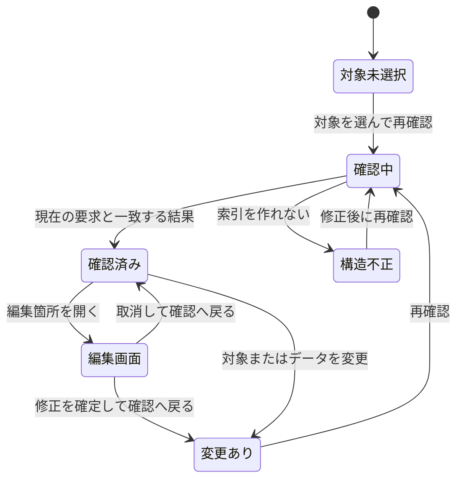

# 段階A：対象別の確認と編集箇所への移動

設計日: 2026-10-16、更新日: 2026-10-17。照合したコード: `de94a65`。

状態: **実装前の詳細設計**。[出力設計の段階A](export-workflow.md)を具体化する。直近で実装した方角ボタン・PARAM隣の実在ポイント選択・配色は現行機能として引き継ぐ。この文書に記す確認画面・診断API・移動APIはまだアプリに存在しない。

[触って確認する設計モック](diagnostics-wireframe.html)は、架空のSCOM A/BとSPECだけを扱う単体HTML。ダウンロードしてブラウザで開く設計説明用で、PythonアプリやE3Dへ接続しない。判定するのは架空部品のPARAM 3不足だけで、下記の全診断APIを実装したものではない。

## 1. この段階で完成させる操作

SCOMまたはSPECを選ぶ → その対象を検査する → 診断を選ぶ → 問題の入力欄を開く → 修正・取消 → 確認画面へ戻る → 再確認する。

- 上部のPTSET → GMSET → SCOM → スペックと、現在の4列の編集画面を使う。
- 「その他の管理 → 確認・マクロ」を入口にし、SCOM/SPECにも「この対象を確認」を置く。
- 確認だけではプロジェクトを変更しない。仮PARAM・仮倍率・実値の補完や、参照の自動修正を行わない。
- 保存/読込のv2契約は変更しない。「未完成でも保存可能」は空欄など既存契約が許す下書きの意味であり、誤った値型や壊れたJSONまで受け入れる意味ではない。
- 新しい検査から実機マクロを出力しない。現在の全行コメント出力は「既存の全体コメント出力」と明記して別操作に残す。選択対象だけを保存したレポートとは表示しない。出力計画の固定と対象別レビュー保存は段階B。

## 2. 確認画面の状態



「確認済み」は検査が完了した状態であり、問題0件を意味しない。画面では「入力・参照の検査完了」と「E3D実機は未確認」を別に示す。

```text
出力前確認                      [対象を選ぶ] [再確認]
範囲: 選択SCOM 2件 → 共通定義2件・CATE1件を含む
修正が必要 1 / 要確認 0 / 案内 0    E3D実機: 未確認

[問題] [参照先]
[すべて ▾] [対象・属性・内容を検索                   ]
状態         対象                 属性       内容
修正が必要   部品B                 PARAM 3    全長の実値がありません

詳細: 部品Bで使う全長。仮PARAMでは代用しません。
[編集箇所を開く]
```

- 範囲は「選択SCOM / 選択SPEC / プロジェクト全体」。対象窓は検索とチェック一覧で選ぶ。SCOMとSPECの選択は別に保持し、範囲切替時に先頭の対象を自動選択しない。
- 対象0件は「対象を選択してください」。問題0件の成功表示にしない。
- 「参照先」はSCOM、定義、説明/材質、既存の親等と、含まれた理由を表示する。所有先の新設・対応付けは段階B。
- 一覧の検索・種別フィルターは表示だけに適用し、検査範囲や総件数を変更しない。検索中は表示件数も示す。
- 診断を1件選ぶと下部に根拠、評価したSCOM、修正先、移動できない場合の理由を出す。赤色だけに頼らず種別名も表示する。
- 未対応の検査群が残る場合は「一部未確認」。実装済み検査で問題がなかっただけで全件確認済みにしない。
- coverageのunsupportedは検査群そのものが未実装の場合。対応外の式を検出して `EXPR_UNSUPPORTED` を出せた場合、その式検査群はcheckedであり、診断の有無と混同しない。

## 3. 読取検査と範囲の決定

現在の `project.validate()` は保存構造に加え、PARAM値型、プリセット、仮配置、確認用設計値、冊子の固定データなども検査する。`project.issues()` はその失敗で全体を中断するため、新しい対象別検査の入口へそのまま置けない。

新しい読取処理は次の2層に分ける。

| 層 | 読むもの | 中断の扱い |
| --- | --- | --- |
| 全体索引 | format/version、現行の生データ配列、辞書のレコード、空でない文字列ID、同じ配列内のID重複 | 一意な参照を解決できない場合は `STORAGE_INVALID`。通常の対象検査を中止 |
| 選択した枝 | 必要な定義のelements/children/attrs、SCOMのvalues、SPECのentriesなど、走査に必要な型・深さ・子ID | 壊れた枝を明示してその枝の検査を止める。他の選択根で独立に確認できる枝は検査する。結果は一部未確認 |

数値PARAMに文字値が入っていても、辞書として読めれば `PARAM_TYPE`。未使用のプリセット、対象外SCOMの値型不一致、過去の冊子、仮配置情報の不備を選択対象の実値検査へ混ぜない。対象外の壊れた属性辞書を理由に、索引自体が壊れたとは判定しない。

参照は `{source, collection, id}`。Aのsourceは `project`。同じIDが別の配列にあっても取り違えない。子要素・SPEC行は親レコードとID列で特定する。表示名、NUMB、並び順を識別子として使わない。

既知の型付き参照（gmset_id等）は、その属性で決まる配列だけを検索する。一方、現行v2の説明・共通表の `parent_id` はCATEまたは共通表を指す配列情報のないIDで、同じIDが両配列に存在できる。複数候補があれば `REF_AMBIGUOUS` とし、候補を名前空間付きの `related` に列挙する。現在の `companion_issues()` のCATE優先を新しい解決規則にせず、親を推測して枝をたどらない。これは全体索引の破損ではなく該当参照の不備で、依存先を確定できない枝は一部未確認とする。v2データの参照型追加・自動修正はこの段階では行わない。

### 範囲を広げる規則

1. 選択SCOMから所属CATE、明示されたPTSET/GMSETと追加参照、使用PARAM規則をたどる。
2. 選択SPECから全行と、各行のSCOM・SDTE・SMTEをたどる。選択SCOMが使われるSPECへ逆向きには広げない。
3. 説明/材質・共通表の既知の親参照もたどる。未知属性の文字列から参照を推測しない。
4. 共通定義の構造は定義ごとに1回、実値評価は `{定義, SCOM}` ごとに行う。共有元のどの部品で失敗したかを保持する。
5. 定義の編集用PTSET対応と、SCOMの明示PTSET参照を別に扱う。編集用対応が曖昧でも、有効なSCOM参照を `REF_MISSING` にしない。
6. 全体確認では現在の生データを対象にし、未使用定義・共通表も検査する。発行済み冊子・要素プリセットの固定内容を、現在の部品定義として混ぜない。これらの管理データの検査は別群として将来追加する。

空の追加参照は任意なら問題にしない。PTSET/GMSET両方を常に実機必須とする規則はクラス別仕様が不足しているため、現在のSCOM編集形式の確認と、実機登録の必須条件を区別する。暗黙TUBE等の例外を推測で実装しない。

## 4. 診断APIと結果

新設予定の `diagnostics.inspect_project(data, roots=None)` はTkから独立した関数にする。`None` は全体、空配列は対象なし。通常の不備は診断で返し、実装自体の例外を問題0件へ変換しない。

| 結果の項目 | 契約 |
| --- | --- |
| `format / version` | `catalog-studio-diagnostics` / 1。保存プロジェクトの形式とは別 |
| `source_digest` | 検査時の固定コピーを識別するダイジェスト。出力設計と同じJSON正規化規則 |
| `requested_roots / included` | 明示した根と、診断のためたどった範囲。全体指定はrequested_roots=null |
| `state` | `empty / complete / partial / invalid`。問題の有無と別 |
| `coverage` | 検査群ごとの `checked / not_applicable / unsupported`。unsupportedや読めない枝があればpartial |
| `diagnostics` | 下記の構造化診断。並び順は重大度、対象の保存順、子の保存順、属性のスキーマ順、コード順 |

```json
{
  "code": "PARAM_MISSING",
  "severity": "error",
  "target": {"source": "project", "collection": "scoms", "id": "demo-b"},
  "element_path": [],
  "field": "P3",
  "context": {"source": "project", "collection": "scoms", "id": "demo-b"},
  "message": "PARAM 3：全長の実値がありません。",
  "blocks": ["execution"],
  "evidence": {"kind": "tool_rule", "source": "SCOM.values / PARAM規則"},
  "edit": {
    "view": "scom_form",
    "target": {"source": "project", "collection": "scoms", "id": "demo-b"},
    "element_path": [],
    "field": "P3"
  },
  "related": []
}
```

基本項目は上位設計を継承し、`edit` と `related` を追加する。`field` はそのレコード/要素に対する属性またはPARAMキー。値の辞書名や日本語メッセージを分割して移動先を推定せず、`edit.view` が示す入力画面へ明示したキーで移動する。

- `edit` は主な修正先。画面がなければ `null`。`related` には同じ原因に関連する定義・部品・プリセット等の場所を保持し、詳細で参照できるようにする。
- `context` は評価に使ったSCOM。定義単体の構造検査ではnull。同じ定義がAでは正常、Bで失敗した場合はBを失わない。
- 重複判定は code・target・element_path・field・context・検査上の追加識別子で行う。PARAM規則のunit等は、追加識別子に対象PARAM番号を含める。
- 構造や必須参照が壊れた枝、またはプリセットが不一致の枝の実値評価を止める。派生するPARAM不足・寸法評価エラーを大量に追加しない。
- 情報の根拠と重大度は別。資料上の規則は `manual`、ツールの編集・対応範囲は `tool_rule`、現在データの参照切れ等は `project_data`。実機記録がない項目を `runtime` にしない。
- Aでは実行用出力機能自体が未対応。`blocks` が空でも実行可能という表示にせず、画面共通で実機出力未対応を示す。

## 5. 最初に構造化する診断

| 検査群 | コード | 内容と移動先 |
| --- | --- | --- |
| 参照 | `REF_MISSING / REF_TYPE / REF_AMBIGUOUS` | 未選択・参照切れ・型違い・配列未指定の親IDの複数候補。参照先でなく参照元の選択欄へ |
| 名前 | `NAME_CONFLICT` | 現在の全体検査と同じcasefold比較を明示。対象内の同名はerror、対象外との同名はinfo。E3D命名規則の確定とはしない |
| PARAM | `PARAM_MISSING / PARAM_TYPE / PARAM_UNDEFINED` | 実値不足、数値/WORD不一致、規則にない値。SCOMの該当PARAMまたは規則を開く |
| 規則 | `PRESET_MISMATCH` | 定義とSCOMの規則不一致。両方の規則を詳細に出し、割当欄へ |
| SPEC | `FIELD_REQUIRED / SPEC_CONDITION_CONFLICT` | type・bore1の不足、条件の重複。該当行を開き、重複する他行もrelatedに保持 |
| 定義構造 | `FIELD_INVALID / FIELD_REQUIRED` | NUMB・重複番号、flag、LEVEL、NAPP、PSKEY、子型・輪郭、明示NAREF不良等。要素または親属性へ |
| 式 | `EXPR_UNSUPPORTED` | 対応文法で解釈できない式。原文を保持したまま属性へ |
| 実値評価 | `CONTEXT_MISSING / DIMENSION_MISMATCH / EVALUATION_ERROR` | 他family値不足、既知の次元不一致、ゼロ除算等を分ける。属性と評価SCOMを示す |
| 共通データ | `REF_MISSING / REF_TYPE / REF_AMBIGUOUS / OWNER_CYCLE / FIELD_INVALID` | 既存親参照・親型・親循環・SKEY・ISODRAFT条件。管理レコードの該当欄へ |
| 編集情報 | `PAIRING_UNRESOLVED` | GMSETの編集用PTSET対応が不明。warning、実機参照切れと別。executionを止める根拠にしない |
| 描画 | `PREVIEW_LIMITATION` | 表示用メッシュの未対応・近似。info。表示できないことだけで実機定義の不正にしない |

POINT番号P1と数値式のPARAM略記P1は属性の意味で区別する。新しい診断から方角・点・式の文字列を正規化して保存しない。任意のPSKEY、DESC、PURPや、省略時の+Y/0を必須入力エラーへ戻さない。

検査群の実装順は、参照・PARAM → SPEC行 → 定義構造 → SCOM別の式評価 → 共通データ。旧 `issues()` の文章を解析してcodeを付けず、原因を検出する共通処理で構造化する。全検査群の移行が終わるまでは旧窓口の規則を失わず、新画面のcoverageで未移行群を示す。最後に `project.issues()` を構造化結果の文字列整形窓口にする。

現在の `expressions.py` / `units.py` の失敗は、文章だけを持つ `ValueError` が中心である。A2で、原因コード・詳細を持つ `ValueError` 互換の例外を導入し、原因を検出した箇所で生成する。既存の `except ValueError` と表示文は維持し、診断側は文章を解析しない。参照family・PARAM番号、属性、期待次元・実際の次元など、判明する項目を詳細に保持する。文法・対応関数・演算結果の規則は変更せず、構文未対応、文脈不足、次元不一致、演算失敗を機械的に区別できるようにする。

## 6. 移動先と必要なUI改修

新しい `navigate_to_diagnostic(diagnostic)` は `opened / container_only / unavailable / cancelled` と理由を返す。表示名ではなく内部IDで現在のデータを再解決する。

| 診断の場所 | 現行の再利用先 | 新しく必要な指定 |
| --- | --- | --- |
| SCOMのgmset_id / ptset_id / cate_id | `scom_form(scom)` | フォームキーgm / pt / cate |
| SCOMのP3、ANGL | 同上 | P3 / anglへスクロール・フォーカス |
| SCOMのparameter_preset_id | `assign_scom_preset()` | 割当先を開く。scom_formのpreset_labelは1候補なので使わない |
| 明示の参照コンテキスト | `edit_contexts()` | 対象SCOMを選び、確認用JSONとして開く |
| SPEC行のscom_id / bore1等 | `entry_form(entry)` | 行IDを維持。scom / bore1等の欄へ |
| 定義の要素・子・属性 | `ConstructionEditor`、`ValueEditor` | 定義ID、子までのID列、属性、評価SCOMを描画後に復元 |
| PTSSETのNAREF | `edit_parent()` | 親属性窓のNAREFを指定 |
| 説明/材質/共通表 | `CompanionEditor` | レコードIDと属性キー。属性フォームキーはattr:属性名 |
| PARAM規則のunit等 | プリセット編集画面 | 対象規則・PARAM・列を表示。新規作成用の適用プリセットは変更しない |

共通 `form()` に任意の `focus_key` を追加し、欄のウィジェットをキーごとに保持する。表示後に当該欄までスクロール・フォーカスするだけで、入力値や候補を変更しない。既存の呼出しでfocus_key未指定なら現在と同じ動作にする。

`ConstructionEditor` は作成時にelement_id/fieldを初期化するため、ページ切替前の代入だけでは足りない。新しい `select_location(element_path, field, context)` で描画後にIDを再照合して選ぶ。登録一覧の検索で対象が隠れていた場合は検索を解除して表示し、その理由を案内する。

## 7. 移動と未確定入力の扱い

1. 診断から移動先を仮解決する。レコードが削除済みなら確認画面に残り、「対象が変更されています。再確認してください」。同名の別要素を開かない。
2. モーダルな属性窓・SCOM/SPECフォームが開いていたら、その窓へ戻し、利用者による確定・取消を先に行う。外からモーダル入力を確定しない。
3. 通常の未確定セル・名前・プリセットドラフトを既存の編集方針に従って処理する。取消または入力不正なら移動先IDを設定しない。
4. 処理後に移動先を再解決し、カテゴリ・レコード・行・要素・属性・評価SCOMの選択をまとめて適用する。
5. 描画後の遅延フォーカスは移動トークンと対象IDを照合する。別画面へ移った後の古いコールバックを適用しない。

現在の `RegisteredBrowser.select()` のようにIDを先に変更してからswitchする順序は、診断移動に使わない。`switch()` と必要な確定処理には成功/中止の結果を返せる入口を加える。

`guard()` はプロジェクト置換・終了用なので内部移動に使わない。通常のdirty状態だけでファイル保存を求めない。`commit_inline()` の順次確定は入力全体のトランザクションではなく、既に確定した編集まで移動失敗時に巻き戻すこともしない。移動先選択の原子性と、利用者が確定したデータの変更を分ける。

不正名を現在の `commit_name()` のように旧名へ戻して成功扱いにしないため、入力を保持して検証結果を返す改修が必要。プリセットの `can_leave()` は取消時にドラフトとページを維持するが、編集中セルの枠が残ることまでは保証しない。

### 全部を開けない場合

- 子や属性だけが消えていたら、現在も存在する親まで開き `container_only` と理由を表示する。先頭要素や別の属性を原因箇所として強調しない。
- SPEC行の参照SCOMが不明なら、その行の参照元を開く。SCOM候補が0件で現行entry_formが開けない場合は、行を選択して理由を表示する。SCOMを自動作成しない。
- 配列未指定のparent_idが曖昧なら候補を表示する。同じIDの候補を選び直すだけではv2上の曖昧さを解消できないため、参照元までの移動と理由の表示にとどめる。一意なIDへの参照変更が可能なときだけ既存の編集手順を案内する。
- 未知属性は既存の読み取り専用行を選ぶ。未実装の設定画面なら詳細と理由だけを出し、無関係な欄へ誘導しない。
- 共有定義のエラーがSCOM Bで発生した場合は、Bを確認用SCOMとして表示する。現在プレビューに選択していたAで評価し直して原因を隠さない。

## 8. 戻る操作と古い結果

確認画面の範囲、検索、種別フィルター、選択した診断キー、スクロール位置をアプリの一時状態として保持する。プロジェクトJSONや冊子へ追加しない。診断から開いた先には「確認へ戻る」を置き、同じ状態へ戻す。

編集窓で取消した場合はデータのダイジェストが変わらず、前の検査結果を保持する。適用でデータが変わった場合は、前回診断を消さず「確認後に変更あり」と表示する。再確認前の行を開くことはできるが、対象IDを毎回再照合する。

検査は固定コピーをワーカーで実行し、Tkの操作はメインスレッドで行う。要求番号とデータ変更番号を持ち、再要求・対象変更・プロジェクト置換後に到着した古い結果を表示しない。計算失敗は「検査できませんでした」と原因を表示し、問題0件へ落とさない。完了時の現在データとダイジェストも照合し、変更を検出した結果は古いものとして扱う。

確認中に新しい要求が来たら待機中の古い要求を取り消す。実行中の処理を安全に止められない場合も、その結果を採用しない。結果の採否とデータ保存を結び付けない。

## 9. 実装と受入の単位

| 単位 | 作るもの | 主な受入シナリオ |
| --- | --- | --- |
| A1: 純粋な検査 | 読取処理、名前空間付き索引、範囲収集、診断型、参照・PARAM・SPEC検査 | A正常/B不備でAだけなら0件、BまたはSPECならBの不足が出る。空選択を成功にしない。検査前後で元データが同一。型付き参照は別配列の同IDを無視し、曖昧なparent_idは候補を示して停止 |
| A2: 定義の診断 | 構造検査とSCOM別評価の分離、原因を保持する互換例外、残る検査群の移行 | 共有GMSETの子の負形状で、正しい子IDとSCOM Bに紐づく。点参照をPARAMへ変換しない。文脈不足・次元不一致・ゼロ除算・文法未対応を文章に依存せず区別。旧ValueError捕捉も維持 |
| A3: 画面と移動 | 確認一覧、状態保持、明示的な移動先、focus_key、描画後の選択 | 他CATEの部品のP4欄、SPEC3行目のSCOM欄、PTSSET親のNAREFへ移動。再描画で先頭行へ戻らない |
| A4: 取消と結果管理 | 未確定入力、戻る、要求番号、古い結果の排除、旧窓口互換 | モーダル入力・不正名・プリセット移動取消で別対象へ移らない。対象削除/同名再作成/並べ替えで取り違えない。編集後は変更あり、古い検査完了を採用しない |

移動・対象選択だけではdirtyにならず、共有仮PARAM・SCOM実値・定義原文が変わらないことをGUIで確認する。取消と、利用者が明示的に適用した編集は別に検証する。構造化検査のテストを保存形式のテストと分け、`project.load/save` が意図せず壊れたデータを受け入れるようになっていないことも確認する。

旧 `project.issues()` の全チェックは、移行先または未移行群へ1つずつ対応付ける。文字列の単純な一致だけでなく、原因コード、対象ID、属性、評価SCOM、対象外の不備を含めないことを確認する。E3D実機確認は別の[確認ケース](e3d-verification.md)で進める。

## 10. 設計モックの検証状況（2026-10-17）

JavaScript構文と、Node上の簡易DOMによる状態遷移を確認した。A単独・B追加・SPEC参照・対象0件、未確定入力、取消・Esc、不正値、確定、値の変更がない確定、古い結果の表示、再確認を対象とした。文書の相対リンクとJSON例も検査した。

この確認はブラウザの描画・ネイティブ入力・実クリックの検証ではない。クラウド環境のブラウザポリシーがローカルHTMLの表示を遮断するため、実表示とブラウザ操作は未確認。PythonアプリのGUI試験やE3D実機試験も、この設計モックの検証には含めない。
